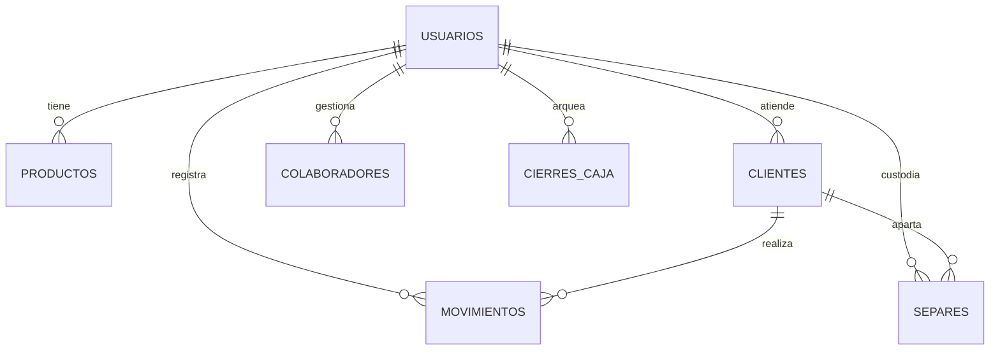

# Manual Maestro de Fiabono — Capítulo 0: Arquitectura del Sistema, Roles y Modelo de Datos

> **Documento Canónico Oficial de Fiabono**  
> **Versión de Software:** 1.0.0 (Producción)  
> **Destinatarios:** Propietarios de Negocio, Administradores, Cajeros, Auditores y Agentes de Inteligencia Artificial (RAG).  
> **Propósito:** Brindar el contexto técnico, operativo y conceptual absoluto de la plataforma Fiabono, detallando cada servicio en la nube, colecciones de datos, flujos de dinero y la matriz exhaustiva de seguridad y permisos.

---

## 1. Ficha Técnica y Ecosistema Tecnológico

Fiabono no es un software tradicional de escritorio ni una aplicación móvil empaquetada que requiera descargas pesadas desde tiendas de aplicaciones. Es una **Plataforma Web Progresiva (PWA)** de alta disponibilidad basada en la arquitectura moderna de la web.

### 1.1. Componentes del Núcleo (Stack)
* **Frontend y Capa de Presentación:** Next.js (App Router con Server Components y Client Components) optimizado con Tailwind CSS para una interfaz reactiva de 60 cuadros por segundo en teléfonos de cualquier gama.
* **Backend y APIs del Servidor:** 44 endpoints en rutas de servidor `/api/*` que procesan transacciones atómicas, validación de cupones, emisión de facturas electrónicas DIAN, gestión de colaboradores y webhooks de pasarela.
* **Base de Datos Principal:** Google Cloud Firestore (Base de datos NoSQL documental en tiempo real). Cada cambio en una venta o producto se propaga a los demás dispositivos en menos de 100 milisegundos mediante sockets persistentes (`onSnapshot`).
* **Autenticación y Seguridad:** Firebase Authentication con sesiones blindadas. Las cuentas de los colaboradores se validan contra credenciales cifradas y roles asociados a la cuenta principal del negocio.
* **Almacenamiento de Multimedia:** Google Cloud Storage para logotipos de comercio y galerías fotográficas de productos y prendas en Plan Separe.
* **Motor de Escaneo Óptico:** Librería `html5-qrcode` con aceleración por hardware mediante `BarcodeDetector` nativo de Google Chromium, con acceso a control de hardware (enfoque continuo `continuous-focus`, linterna `torch` y zoom digital variable por WebRTC `MediaStreamTrack`).
* **Generación Gráfica Vectorial:** `jsbarcode` (renderizado SVG de Código de Barras 1D Code 128 universal) y `qrcode` (matriz bidimensional 2D).
* **Motor de Impresión y Documentos:** Impresión térmica directa POS (rollos de 58mm y 80mm) con estilos CSS `@media print` de contraste puro, y generación de documentos PDF de alta resolución mediante `jspdf`.
* **Pasarela de Pagos Recurrentes:** Integración directa con Wompi Colombia (Bancolombia) para el recaudo automatizado de las suscripciones mensuales y anuales mediante tarjeta de crédito o PSE.

---

## 2. Mapa Completo de Colecciones de Base de Datos (Firestore)

Para entender cómo funciona cualquier botón o pantalla de Fiabono, es imprescindible conocer la estructura de datos que se modifica por debajo. Toda la información del negocio se organiza en 8 colecciones clave:



### 2.1. Colección `usuarios` (Configuración del Negocio)
Es el documento raíz de cada comercio. Su ID en Firestore corresponde al `uid` de autenticación del dueño del negocio.
* `nombreNegocio` *(String)*: Nombre comercial visible en el encabezado, tickets y enlaces públicos.
* `rubroNegocio` *(String)*: Categoría comercial (ej: `moda_ropa`, `calzado`, `tecnologia`, `abarrotes`, `servicios`).
* `categoriasPersonalizadas` *(Array de Strings)*: Lista de categorías activas creadas para organizar el inventario.
* `telefonoNegocio` *(String)*: Teléfono o línea WhatsApp del comercio.
* `nitNegocio` *(String)*: Número de identificación tributaria o cédula del propietario.
* `direccionNegocio` *(String)*: Dirección física del local.
* `logoNegocio` *(String URL)*: Enlace a la imagen optimizada del logo para los tickets.
* `mensajePieTicket` *(String)*: Texto de agradecimiento o políticas de cambio que se imprime al final de los recibos.
* `mediosPago` *(Map)*: Configuración de medios de pago activos (Efectivo, Nequi, Daviplata, Bancolombia, Tarjeta de Crédito, etc.).
* `moduloSepareActivo` *(Boolean)*: Bandera que activa o desactiva la visibilidad del módulo de Plan Separe en todo el sistema.
* `habilitarIva` *(Boolean)* y `porcentajeIva` *(Number)*: Configuración fiscal para discriminar IVA en los cobros.
* `planActual` *(String)*: Nivel de suscripción activo (`gratis`, `comercio`, `pro`).
* `diasPro` *(Timestamp)*: Fecha de vencimiento del período de prueba o suscripción activa.

### 2.2. Colección `colaboradores` (Usuarios de Empleados)
Documentos subordinados a la cuenta principal. Permite que el dueño no tenga que compartir su correo ni contraseña personal con los empleados.
* `cuentaPrincipalId` *(String)*: ID del negocio al que pertenece el colaborador.
* `nombre` *(String)*: Nombre completo del empleado o vendedor.
* `usuarioAcceso` *(String)*: Nombre de usuario único con el que inicia sesión.
* `passwordHash` *(String)*: Clave de acceso cifrada.
* `rol` *(String)*: `colaborador` o `cajero`.
* `permisos` *(Map de Booleans)*: Los 18 permisos individuales que determinan exactamente qué botones puede tocar y cuáles no.

### 2.3. Colección `productos` (Inventario Maestro)
Cada ítem o prenda física disponible para la venta.
* `cuentaPrincipalId` *(String)*: Identificador del comercio propietario.
* `nombre` *(String)*: Nombre comercial del producto (ej: `Pantalón Jean Clásico`).
* `sku` *(String)*: Código alfanumérico único (código de barras o QR).
* `categoria` *(String)*: Categoría a la que pertenece (ej: `Pantalones`).
* `stock` *(Number)*: Cantidad física real disponible en bodega o vitrina.
* `precioVenta` *(Number)*: Precio de venta al público en pesos colombianos.
* `costoCompra` *(Number)*: Costo de adquisición o compra al proveedor (confidencial).
* `imagen` *(String URL)*: Fotografía del producto para reconocimiento visual en caja.
* `tipoProducto` *(String)*: `producto` (descuenta inventario) o `servicio` (no requiere stock).
* `stockMinimo` *(Number)*: Umbral para disparar alertas amarillas de reabastecimiento.

### 2.4. Colección `clientes` (Directorio y Cuentas por Cobrar)
Almacena el historial y la deuda de cada cliente que compra a crédito o separa mercancía.
* `nombre` *(String)*: Nombre del cliente.
* `celular` *(String)*: Número telefónico para contacto y envío de tickets por WhatsApp.
* `totalDeuda` *(Number)*: Monto total exacto que debe al negocio actualmente.
* `saldoAFavor` *(Number)*: Anticipos o saldos a favor por devoluciones o notas crédito.
* `limiteCredito` *(Number)*: Cupo máximo autorizado para fiarle mercancía.
* `estadoMora` *(String)*: `al_dia`, `proximo_a_vencer` o `vencido`.
* `fechaUltimoMovimiento` *(Timestamp)*: Fecha de la última compra o abono.

### 2.5. Colección `movimientos` (Libro Mayor Inmutable)
Registro histórico de cada transacción que ocurre en el negocio. No se edita; si se comete un error, se anula creando una trazabilidad.
* `tipo` *(String)*: `venta`, `fiado`, `abono`, `devolucion`, `anulacion_venta`, `anulacion_abono`, `gasto`.
* `total` *(Number)*: Valor monetario total de la operación.
* `clienteId` *(String, opcional)*: ID del cliente si la transacción fue personalizada, fiada o abonada.
* `colaboradorId` *(String)*: Identificador del empleado que realizó la transacción en caja.
* `items` *(Array de Objetos)*: Lista de productos vendidos con cantidad, precio unitario, costo y subtotal.
* `mediosPago` *(Map)*: Desglose de cómo pagó el cliente (ej: `$50.000` en Efectivo y `$30.000` por Nequi).
* `vuelto` *(Number)*: Cambio o dinero devuelto al cliente en efectivo.
* `ticketId` *(String)*: Código alfanumérico corto para el ticket público.
* `fecha` *(Timestamp)*: Momento exacto de la operación en el servidor.

### 2.6. Colección `separes` (Planes Separe y Apartados)
Controla los productos que han sido apartados por clientes mediante abonos parciales.
* `codigo` *(String)*: Código visible del apartado (ej: `SEP-0412`).
* `clienteId` *(String)*: Cliente titular del separe.
* `items` *(Array de Objetos)*: Prendas o productos apartados (el stock se descuenta del inventario disponible para evitar que otros lo vendan).
* `valorTotal` *(Number)*: Precio total de la mercancía apartada.
* `valorAbonado` *(Number)*: Suma de todos los anticipos y abonos recibidos.
* `saldoPendiente` *(Number)*: Dinero que le falta pagar al cliente para poder retirar la mercancía.
* `fechaCreacion` y `fechaLimite` *(Timestamp)*: Plazo máximo pactado para liquidar el apartado.
* `estado` *(String)*: `activo`, `liquidado`, `entregado`, `vencido`, `cancelado`.
* `fotos` *(Array de Strings URL)*: Fotografías tomadas a la prenda o mercancía al momento de apartarla.

### 2.7. Colección `cierres_caja` (Arqueos Diarios)
Garantiza el control contra descuadres o pérdidas en el mostrador.
* `baseInicial` *(Number)*: Dinero con el que se abrió el turno para dar cambio.
* `totalVentasEfectivo` *(Number)*: Dinero recaudado en efectivo por ventas de contado.
* `totalAbonosEfectivo` *(Number)*: Dinero recaudado en efectivo por cobro de deudas.
* `totalEfectivoEsperado` *(Number)*: Suma matemática calculada por el sistema.
* `totalEfectivoReal` *(Number)*: Dinero físico contado por el cajero al final del turno.
* `diferencia` *(Number)*: Descuadre (`0` = caja cuadrada, negativo = faltante, positivo = sobrante).
* `estado` *(String)*: `abierta` o `cerrada`.

---

## 3. Matriz Exhaustiva de Seguridad: Los 18 Permisos Granulares

Cuando el Administrador ingresa a `/dashboard/perfil` en la sección **Colaboradores**, puede activar o desactivar de forma independiente 18 permisos para cada empleado. A continuación se detalla el comportamiento exacto de cada uno:

```
[ Matriz de Permisos de Colaborador en Fiabono ]
 ├─ Acceso a Información de Clientes
 │   ├─ 1. verCelulares
 │   ├─ 2. verDirectorio
 │   └─ 3. verCartera
 ├─ Operaciones de Caja y Venta
 │   ├─ 4. ventaDirecta
 │   ├─ 5. abonar
 │   ├─ 6. modificarPrecios
 │   ├─ 7. aplicarDescuentos
 │   └─ 8. terminalMultivendedor
 ├─ Control de Mercancía
 │   ├─ 9. editarInventario
 │   ├─ 10. ingresoInventario
 │   └─ 11. planSepare
 ├─ Auditoría y Supervisión
 │   ├─ 12. anularVentas
 │   ├─ 13. anularAbonos
 │   ├─ 14. hacerCierreCaja
 │   ├─ 15. verReportes
 │   ├─ 16. verCostos
 │   ├─ 17. exportarExcel
 │   └─ 18. enviarWhatsApp
```

### Detalle Operativo de cada Permiso:

#### 1. `verCelulares` (Protección de Base de Datos de Clientes)
* **Si está ACTIVO:** El colaborador puede ver el número de WhatsApp completo del cliente (ej: `310 456 7890`) en todas las listas y modales.
* **Si está INACTIVO:** El sistema enmascara automáticamente los dígitos centrales (ej: `310 *** **90`). Esto evita que empleados desleales copien la base de datos de clientes para llevársela a la competencia.

#### 2. `verDirectorio` (Acceso al Módulo de Clientes)
* **Si está ACTIVO:** El colaborador tiene acceso al enlace `/dashboard/clientes`, donde puede explorar todos los clientes registrados.
* **Si está INACTIVO:** El menú oculta el botón de Clientes. Si el colaborador intenta entrar directamente por la URL, el sistema lo expulsa hacia el inicio con la notificación: *"No tienes permisos para ver esta sección"*. (Aun así puede asignarle una venta a un cliente buscándolo por nombre en caja).

#### 3. `verCartera` (Visibilidad de Deudas Totales del Negocio)
* **Si está ACTIVO:** El colaborador ve el indicador de cuánto dinero en total le deben al negocio y el saldo individual de cada deudor.
* **Si está INACTIVO:** Las cifras globales de cartera se ocultan con candados y el colaborador no puede consultar el saldo acumulado general del negocio.

#### 4. `ventaDirecta` (Cobro Inmediato vs Modo Preventa / Comanda)
* **Si está ACTIVO:** El colaborador puede cobrar y emitir el ticket de inmediato. El dinero entra a caja y el stock se descuenta al momento.
* **Si está INACTIVO:** El colaborador trabaja como **vendedor de pasillo (Preventa)**. Al terminar de armar el carrito no le sale el botón de "Cobrar", sino **"Crear Orden / Comanda"**. La orden viaja a `/dashboard/ordenes` para que el cajero principal la revise, cobre el dinero y entregue el paquete.

#### 5. `abonar` (Recepción de Pagos de Cartera)
* **Si está ACTIVO:** El colaborador puede entrar a `/dashboard/abonar`, recibir dinero de clientes morosos y emitir recibos de caja.
* **Si está INACTIVO:** El botón de abonar aparece deshabilitado. No puede recaudar cartera.

#### 6. `editarInventario` (Gestión de Catálogo Maestro)
* **Si está ACTIVO:** Permite crear nuevos productos, cambiar nombres, alterar categorías, modificar precios de venta y eliminar referencias.
* **Si está INACTIVO:** El colaborador no ve los botones de edición (`✏️`) ni de eliminación (`🗑️`). Solo puede consultar el catálogo.

#### 7. `ingresoInventario` (Recepción Rápida de Mercancía)
* **Si está ACTIVO:** Permite usar el escáner rápido para sumar unidades que llegaron de fábrica (+1, +10 un.), pero **sin poder alterar los precios de venta ni el nombre del producto**.
* **Si está INACTIVO:** No puede registrar entradas de mercancía.

#### 8. `terminalMultivendedor` (Comisiones Compartidas)
* **Si está ACTIVO:** Al momento de cobrar en caja, aparece un selector que pregunta: *¿Qué vendedor atendió esta venta?*. Permite que un solo cajero liquide ventas atendidas por diferentes asesores de piso.
* **Si está INACTIVO:** La venta se asocia automáticamente al usuario que tiene la sesión iniciada en ese dispositivo.

#### 9. `modificarPrecios` (Seguridad de Precios en Mostrador)
* **Si está ACTIVO:** El cajero puede tocar el precio de un producto en el carrito de venta y escribir un valor diferente.
* **Si está INACTIVO:** El precio unitario está bloqueado. El producto se vende estrictamente al precio registrado en el sistema.

#### 10. `aplicarDescuentos` (Rebajas y Promociones)
* **Si está ACTIVO:** Habilita el botón de descuento (porcentaje `%` o dinero fijo `$`) al total de la venta.
* **Si está INACTIVO:** El campo de descuento no se muestra en pantalla.

#### 11. `planSepare` (Gestión de Apartados)
* **Si está ACTIVO:** Permite crear planes separe en `/dashboard/separe`, recibir anticipos y entregar prendas en `/dashboard/separes`.
* **Si está INACTIVO:** El módulo de separe y los botones de apartado en las tarjetas de inventario desaparecen de la vista del colaborador.

#### 12. `anularVentas` (Control Antifraude en Ventas)
* **Si está ACTIVO:** El colaborador puede entrar al historial, presionar "Anular Venta" y devolver el stock a la bodega.
* **Si está INACTIVO:** No aparece el botón de anular. Solo el Administrador principal puede autorizar la cancelación de una venta ya cobrada.

#### 13. `anularAbonos` (Control Antifraude en Cartera)
* **Si está ACTIVO:** Permite reversar un abono mal digitado.
* **Si está INACTIVO:** Solo el Administrador puede anular recibos de dinero por abono.

#### 14. `hacerCierreCaja` (Arqueo y Cuadre de Turno)
* **Si está ACTIVO:** El colaborador tiene acceso al botón de apertura de turno (ingresar base) y al botón de Cierre de Caja (contar billetes y cerrar turno).
* **Si está INACTIVO:** El colaborador solo opera la caja; el arqueo ciego y cierre lo debe ejecutar el Administrador o supervisor.

#### 15. `verReportes` (Estadísticas y Utilidades del Negocio)
* **Si está ACTIVO:** Acceso total a gráficos de ventas, mejores clientes y rendimiento mensual.
* **Si está INACTIVO:** Bloqueo total de la ruta `/dashboard/reportes`.

#### 16. `verCostos` (Secreto Comercial de Proveedores)
* **Si está ACTIVO:** El usuario puede ver cuánto costó comprar la mercancía y cuál es la ganancia neta en pesos y porcentaje.
* **Si está INACTIVO:** Los costos se ocultan por completo en todo el sistema. El empleado solo ve el precio de venta final.

#### 17. `exportarExcel` (Seguridad de Información)
* **Si está ACTIVO:** Permite descargar archivos `.xlsx` y reportes en Excel de inventarios y clientes.
* **Si está INACTIVO:** Los botones de exportar desaparecen para evitar fugas masivas de datos en memorias USB o correos.

#### 18. `enviarWhatsApp` (Disparo de Notificaciones)
* **Si está ACTIVO:** Abre automáticamente la API de WhatsApp Web o la App de WhatsApp con el mensaje estructurado y enlace al ticket digital.
* **Si está INACTIVO:** Solo permite imprimir en papel físico térmico o cerrar la ventana de cobro sin interactuar con WhatsApp.

---

## 4. Filosofía del Escaneo de Códigos: QR vs. Código de Barras

Una de las dudas más frecuentes de los comerciantes al comenzar a utilizar Fiabono es:  
*¿Por qué mis etiquetas deben generarse preferiblemente en Código QR y no en el código de barras tradicional de rayitas?*

### 4.1. Limitaciones Físicas de los Teléfonos Celulares
* **La distancia focal:** La cámara de un smartphone estándar tiene una distancia mínima de enfoque de **15 a 20 centímetros**. Si un usuario acerca el teléfono a 5 centímetros de un código de barras de líneas (1D), la lente no puede enfocar físicamente y la imagen se vuelve borrosa.
* **Grosor de las líneas:** Un código de barras 1D (Code 128 o EAN-13) depende de rayitas verticales de menos de 1 milímetro. Si una sola rayita se desenfoca o le pega el reflejo de una luz del techo, el escáner lo rechaza.

### 4.2. Por qué el Código QR (2D) es la Opción Superior para Celulares
1. **Lectura Multidireccional:** El código QR tiene 3 cuadros de anclaje en sus esquinas. No importa si el celular está de cabeza, torcido o en diagonal: el algoritmo detecta la posición de inmediato.
2. **Corrección de Errores Reed-Solomon:** El código QR almacena redundancia matemática. Puede estar arrugado, doblado o sucio en un 30% y la cámara lo decodifica en 50 milisegundos.
3. **Pistolas 2D:** Si el negocio decide comprar una pistola lectora moderna de \$80.000 COP, estas pistolas utilizan tecnología de cámara ("Imager") y leen Códigos QR a la misma velocidad supersónica que las líneas tradicionales.

---

## 5. Glosario Canónico de Términos del Sistema

* **Ticket Público (`/t/[id]`):** URL web única cifrada que se envía por WhatsApp al cliente. Permite que el cliente vea desde su propio teléfono el recibo con el logo del negocio, los productos comprados, la fecha y el saldo restante, sin tener que descargar ninguna app ni registrarse.
* **Stock de Seguridad:** Cantidad mínima de un producto que debe permanecer en vitrina antes de que el sistema pinte la tarjeta de color amarillo advirtiendo necesidad de reabastecimiento.
* **Déficit de Inventario:** Estado en el que el stock queda en números negativos (ej: `-2 un.`), lo cual ocurre cuando el negocio vende mercancía que físicamente tiene en el local pero que aún no había ingresado al sistema. Fiabono permite no frenar la venta, registrando el déficit para luego compensarlo al recibir la factura de compra.
* **Preventa / Comanda:** Modalidad de venta donde un asesor genera una solicitud de productos sin recibir dinero, la cual queda flotando en el sistema hasta que el cajero de mostrador la cobra físicamente.
* **Arqueo Ciego:** Práctica recomendada de control de caja donde el cajero cuenta los billetes físicos sin que el sistema le diga previamente cuánto debería haber, evitando manipulaciones de dinero.
