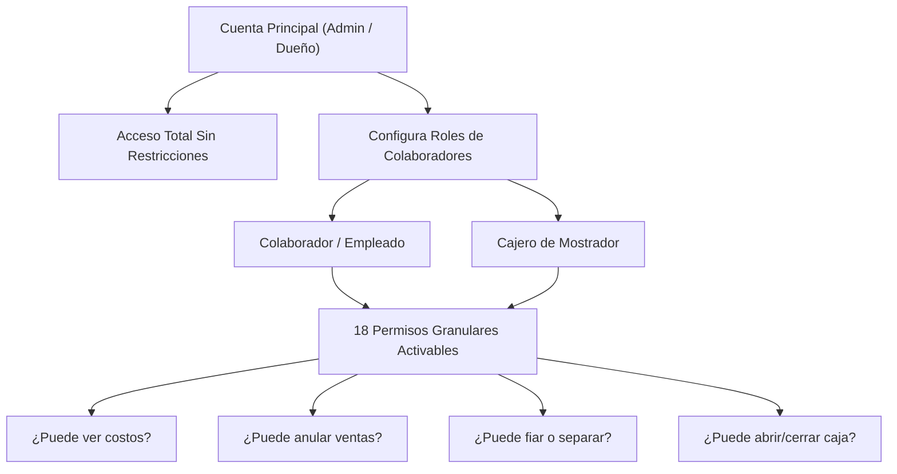

# Manual Maestro de Fiabono — Capítulo 0: Arquitectura, Roles y Glosario General

> **Versión del Sistema:** Fiabono v1.0 (Producción)  
> **Propósito:** Documento canónico de referencia operativa, soporte a usuarios y Base de Conocimiento (Knowledge Base) para entrenamiento e ingesta de Agentes de Inteligencia Artificial (RAG).  
> **Última Actualización:** Octubre 2026.

---

## 1. ¿Qué es Fiabono?

**Fiabono** es una plataforma integral de Punto de Venta (POS), Control de Inventario, Gestión de Créditos (Fiados), Abonos de Cartera y Plan Separe, diseñada especialmente para comercios minoristas (retail, moda, calzado, tecnología, tiendas de barrio, abarrotes y servicios).

### Filosofía y Principios de Diseño
1. **Democratización Tecnológica (Cero Hardware Costoso):** Un comerciante no necesita invertir millones de pesos en computadores industriales ni lectores láser especializados. Fiabono convierte cualquier teléfono celular, tablet o laptop en una caja registradora de alta velocidad.
2. **Mobile-First Real:** Más del 90% de los usuarios operan desde un celular. Toda la interfaz cuenta con navegación táctil ergonómica para el pulgar, tarjetas en 3 filas sin colisiones, barras flotantes inteligentes y retroalimentación táctil por vibración (`vibrarToque`).
3. **Escaneo Híbrido Inteligente:** Soporta tanto Códigos QR (2D) de lectura instantánea para celulares como Códigos de Barras tradicionales (1D / Code 128) para cajas con pistolas láser físicas.
4. **Nube en Tiempo Real con Firebase:** Los datos se sincronizan al milisegundo mediante Google Cloud Firestore. Si el dueño abre el sistema en su computador y un vendedor cobra desde el celular en el pasillo, el inventario y la caja se actualizan al instante.
5. **Comprobantes Digitales Vía WhatsApp:** Sin depender obligatoriamente de impresoras de papel, todos los recibos, estados de cuenta y recordatorios de cobro se despachan al WhatsApp del cliente con un solo toque, incluyendo un enlace web público (`/t/[id]`) interactivo.

---

## 2. Mapa Completo del Manual Maestro

El manual se organiza en 14 capítulos modulares e interconectados:

* **[Capítulo 0: Arquitectura, Roles y Glosario General](00_INDICE_Y_ARQUITECTURA_GENERAL.md)** *(Este documento)*
* **Capítulo 1:** Registro, Onboarding y Configuración del Negocio (Perfil, Logo, Medios de Pago y Tickets).
* **Capítulo 2:** Panel de Inicio y Caja Mostrador (Apertura, movimientos en vivo y arqueo de turno).
* **Capítulo 3:** Módulo de Inventario Maestro (Alta de productos, variantes, costos vs precios, alertas de stock, escáner híbrido, generador de etiquetas térmicas/carta e importación masiva Excel).
* **Capítulo 4:** Punto de Venta (POS) — Venta Rápida de Contado (Búsqueda, carrito, pagos mixtos, cambio/vuelto, recibo térmico y WhatsApp).
* **Capítulo 5:** Módulo de Crédito y Fiados (Creación exprés de clientes, cupo crediticio, plazos, intereses de mora y pagaré digital).
* **Capítulo 6:** Módulo de Abonos y Recaudos (Abonos parciales, liquidación de deudas, saldo restante y recibos de caja).
* **Capítulo 7:** Módulo de Plan Separe Integral (Creación, anticipo mínimo, fecha límite, bloqueo de inventario, entregas parciales/totales, entrega fiada, galería fotográfica y cancelaciones).
* **Capítulo 8:** Directorio de Clientes y Cobranza Amable (Historial del cliente, estados de morosidad y mensajes automatizados por WhatsApp).
* **Capítulo 9:** Historial y Auditoría de Movimientos (Línea de tiempo inmutable, anulación controlada de ventas y abonos).
* **Capítulo 10:** Reportes y Analítica Financiera (Ingresos brutos, costo de mercancía vendida, utilidad neta, ranking de productos estrella, comisiones de vendedores y exportación contable).
* **Capítulo 11:** Colaboradores, Cajeros y Seguridad (Gestión de personal y desglose exhaustivo de los 18 permisos individuales).
* **Capítulo 12:** Suscripciones, Planes y Facturación (Planes Básico, Comercio y Pro, pasarela Wompi, pruebas gratis y módulo DIAN).
* **Capítulo 13:** Base de Conocimiento para Agentes de IA (Matriz de preguntas frecuentes, diagnóstico de errores y árboles de decisión de soporte).

---

## 3. Matriz de Roles y Niveles de Acceso

Fiabono implementa un sistema de control de acceso basado en roles (RBAC) con dos niveles principales y una capa de 18 permisos granulares:

### Tipos de Usuario
1. **Cuenta Principal (`tipoUsuario: 'principal'`):**
   - Es el propietario del negocio que creó la cuenta.
   - Tiene acceso ilimitado a todas las pantallas, configuraciones fiscales, pasarelas de pago, creación de colaboradores, auditorías y eliminación de registros.
2. **Colaborador / Cajero (`rol: 'colaborador' | 'cajero'`):**
   - Cuenta creada por el Administrador con un nombre de usuario y contraseña específicos.
   - Solo puede ver y operar las funciones que el Administrador le haya concedido explícitamente mediante los **18 permisos individuales**.
   - No puede ver datos de facturación de la suscripción Wompi ni modificar la cuenta bancaria del negocio.

---

### Tabla Maestra de los 18 Permisos Granulares

| # | Identificador Interno | Nombre Visible en Pantalla | ¿Qué Permite si está ACTIVO? | ¿Qué Pasa si está INACTIVO? |
| :-: | :--- | :--- | :--- | :--- |
| **1** | `verCelulares` | Ver Celulares de Clientes | Permite ver el número de WhatsApp completo del cliente. | El teléfono se enmascara con asteriscos (ej: `300***1234`) para proteger la privacidad de la cartera. |
| **2** | `verDirectorio` | Ver Directorio de Clientes | Permite entrar a la sección `/dashboard/clientes`. | Oculta la sección y restringe la búsqueda a asignación exclusiva en caja. |
| **3** | `verCartera` | Ver Cartera y Deudas Totales | Muestra cuánto debe cada cliente y el total de cuentas por cobrar. | El colaborador solo puede cobrar el valor puntual que le indiquen, sin ver saldos globales de cartera. |
| **4** | `verReportes` | Ver Reportes Financieros | Acceso a `/dashboard/reportes`, utilidades y gráficos de ingresos. | Bloquea la ruta `/dashboard/reportes` y redirige a `/dashboard/inicio`. |
| **5** | `ventaDirecta` | Venta Directa en Mostrador | El colaborador puede cerrar ventas y asentar cobros inmediatamente. | Trabaja en "Modo Comanda / Preventa": crea pedidos que quedan en `/dashboard/ordenes` a la espera de aprobación del cajero. |
| **6** | `abonar` | Registrar Abonos de Clientes | Permite recibir dinero y registrar pagos en `/dashboard/abonar`. | Deshabilita el botón de abonar en todas las vistas. |
| **7** | `editarInventario` | Crear / Editar Productos | Permite crear nuevos productos, cambiar precios base, nombres y borrar ítems. | Bloquea el botón de edición y formulario maestro de inventario. |
| **8** | `ingresoInventario` | Sumar Stock Rápido (Recepción) | Permite escanear o sumar unidades recibidas de mercancía sin modificar precios. | No permite alterar el conteo físico de unidades. |
| **9** | `terminalMultivendedor` | Terminal Multivendedor | Permite atribuir una venta a otro vendedor del equipo para liquidación de comisiones. | La venta se registra automáticamente a nombre del usuario que tiene la sesión abierta. |
| **10** | `modificarPrecios` | Modificar Precios en Venta | Permite cambiar el precio unitario del producto al momento de agregarlo al carrito. | El precio queda bloqueado al valor fijado en el inventario. |
| **11** | `aplicarDescuentos` | Aplicar Descuentos en Caja | Permite aplicar rebajas porcentuales o en valor directo al total del ticket. | El campo de descuento no se muestra o aparece deshabilitado. |
| **12** | `planSepare` | Gestionar Plan Separe | Permite crear apartados, registrar anticipos y entregar mercancía en `/dashboard/separes`. | Oculta el módulo de separe y los botones de apartado en inventario. |
| **13** | `anularVentas` | Anular Ventas Asentadas | Permite cancelar una venta en el historial y devolver el stock a la bodega. | Solo el Administrador puede anular ventas. |
| **14** | `anularAbonos` | Anular Abonos de Cartera | Permite reversar un abono equivocado y restaurar la deuda al cliente. | Solo el Administrador puede anular abonos. |
| **15** | `hacerCierreCaja` | Apertura y Cierre de Caja | Permite abrir turno con base inicial y realizar el arqueo de caja diario. | El colaborador solo vende; el conteo y cierre final lo ejecuta el supervisor. |
| **16** | `verCostos` | Ver Costos de Compra | Muestra el costo mayorista del producto y el porcentaje de ganancia bruta. | Los costos y utilidades quedan totalmente ocultos; solo ve precios de venta al público. |
| **17** | `exportarExcel` | Exportar Bases de Datos | Habilita los botones de descarga de Excel en inventario, clientes y reportes. | Oculta las opciones de exportación para evitar fuga de información. |
| **18** | `enviarWhatsApp` | Enviar Tickets por WhatsApp | Habilita el botón de envío directo de comprobantes y recordatorios por WhatsApp. | Solo permite imprimir ticket térmico físico o cerrar la venta sin disparar la API de WhatsApp. |

---

## 4. Glosario Canónico de Términos de Negocio

Para garantizar total claridad entre usuarios humanos y agentes de soporte de IA, se definen los siguientes términos:

1. **Movimiento:** Cualquier transacción financiera o de inventario registrada con fecha y hora inmutable. Tipos de movimientos: `venta`, `fiado`, `abono`, `devolucion`, `anulacion_venta`, `anulacion_abono`, `gasto` o `apertura_caja`.
2. **Venta de Contado:** Transacción donde el cliente paga el 100% del valor al instante a través de uno o varios medios de pago autorizados (Efectivo, Nequi, Daviplata, Tarjeta, etc.). Descarga el inventario inmediatamente.
3. **Fiado (Crédito de Confianza):** Transacción donde el cliente se lleva la mercancía sin pagar el total o pagando un anticipo parcial. El saldo pendiente se suma a la cuenta deudora del cliente en la colección `clientes`.
4. **Plan Separe (Apartado):** Modalidad donde el cliente reserva un producto entregando un valor inicial (anticipo). **La mercancía NO sale del local** hasta que se liquide el 100%, pero las unidades quedan **retenidas/bloqueadas** en inventario para que ningún otro vendedor las pueda vender.
5. **Abono:** Ingreso de dinero registrado a nombre de un cliente que reduce su saldo en mora o aporta al saldo de un Plan Separe.
6. **SKU / Código de Identificación:** Código único alfanumérico que identifica a una referencia de producto (ej: `ROPA-001`, `770123456789`). Es el texto que se codifica dentro de los códigos QR o de barras.
7. **Código QR (2D):** Código gráfico bidimensional cuadrado. Es la opción prioritaria recomendada en Fiabono por su lectura instantánea desde cualquier ángulo y distancia en teléfonos celulares.
8. **Código de Barras (1D / Code 128):** Código gráfico de líneas paralelas verticales. Se utiliza en etiquetas térmicas cuando el negocio dispone de pistolas lectoras láser de mostrador.
9. **Caja Mostrador (Turno):** Registro operativo que controla el dinero físico en efectivo y en bancos durante una jornada de trabajo, desde la base inicial de apertura hasta el arqueo final.
10. **Ticket Digital Público (`/t/[id]`):** Página web ligera y pública a la que puede acceder cualquier cliente desde su celular mediante un enlace único enviado por WhatsApp, donde consulta su factura, los productos adquiridos, los abonos realizados y el saldo pendiente sin necesidad de registrarse.

---

## 5. Directrices para Agentes de IA de Soporte

Cuando este documento sea consumido por un modelo de lenguaje o agente conversacional de soporte al cliente, el agente debe seguir estas 4 reglas estrictas:

1. **Verificación de Permisos:** Si un usuario reporta que *"no me sale el botón de anular"*, *"no puedo ver los reportes"* o *"no puedo cambiar precios"*, el agente de IA **debe verificar primero si el usuario es Administrador o Colaborador** y recordarle qué permiso específico de la tabla debe habilitarle el dueño de la cuenta.
2. **Distinción entre Fiado y Separe:** Nunca confundir un fiado con un separe. En el fiado, el cliente *se lleva la prenda*; en el separe, la prenda *se queda guardada en la tienda* hasta que termine de pagar.
3. **Consejos de Escaneo:** Si un usuario reporta lentitud leyendo códigos con el celular, recordarle siempre los dos principios físicos:
   - Los **Códigos QR** leen al instante a cualquier distancia.
   - En **Códigos de Barras**, debe mantener el celular a **15-20 cm de distancia** o presionar el botón **Zoom 2x**, evitando reflejos de luz directos sobre plásticos brillantes.
4. **Tono de Comunicación:** Amable, profesional, directo, comprensivo con la realidad de los comerciantes y enfocado en soluciones paso a paso.
