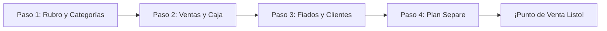

# Manual Maestro de Fiabono — Capítulo 1: Registro, Onboarding y Configuración del Negocio

> **Versión de Software:** 1.0.0 (Producción)  
> **Destinatarios:** Comerciantes, Administradores de Tienda y Agentes de IA de Soporte.  
> **Propósito:** Guía exhaustiva paso a paso de la creación de cuenta, configuración inicial del comercio, personalización visual de tickets, pasarelas bancarias y parametrización fiscal.

---

## 1. Acceso a la Plataforma y Registro de Cuenta

Para utilizar Fiabono, el comerciante ingresa a la aplicación web desde cualquier navegador (Google Chrome, Safari, Edge o Mozilla) en su teléfono móvil o computadora.

### 1.1. Pantalla de Inicio de Sesión (Login)
* **Ubicación:** Pantalla principal de bienvenida (`/`).
* **Campos Requeridos:**
  1. **Correo Electrónico:** Texto con formato de correo estándar (ej: `micomercio@gmail.com`). No distingue entre mayúsculas y minúsculas.
  2. **Contraseña:** Mínimo 6 caracteres alfanuméricos. Cuenta con un icono de ojo (`👁️`) para visualizar u ocultar la clave.
* **Acciones Disponibles:**
  * **Botón `[ Iniciar Sesión ]`:** Valida las credenciales contra Firebase Authentication. Si son correctas, consulta el rol del usuario:
    * Si es **Administrador principal**, redirige a `/dashboard/inicio`.
    * Si es **Colaborador / Cajero**, consulta sus permisos y lo sitúa en su pantalla autorizada.
  * **Enlace `¿Olvidaste tu contraseña?`:** Abre el modal de recuperación de clave. Solicita el correo y dispara un enlace seguro de restablecimiento provisto por Firebase.
  * **Pestaña / Botón `[ Crear Cuenta Nueva ]`:** Despliega el formulario de registro.

---

### 1.2. Formulario de Registro de Nuevo Comercio
Para abrir un negocio en Fiabono solo se requieren 4 datos esenciales:

```
[ Formulario de Registro ]
 ├─ Nombre del Propietario (ej: Carlos Mendoza)
 ├─ Nombre del Negocio (ej: Boutique Elegancia)
 ├─ Correo Electrónico (ej: contacto@elegancia.com)
 └─ Contraseña (mínimo 6 caracteres)
```

#### Validaciones y Reglas de Negocio:
1. **Nombre del Propietario:** Obligatorio. Se utiliza para personalizar la bienvenida y los comunicados oficiales.
2. **Nombre del Negocio:** Obligatorio. Se asigna como nombre por defecto del comercio y genera automáticamente el **Slug Web** (ej: `fiabono.com/tienda/boutique-elegancia`).
3. **Correo Electrónico:** Debe ser único. Si el correo ya existe en la base de datos de Firebase, el sistema muestra la alerta en rojo: *"Este correo electrónico ya se encuentra registrado. Inicia sesión o recupera tu clave"*.
4. **Contraseña:** Si tiene menos de 6 caracteres, Firebase rechaza la petición indicando: *"La contraseña debe tener al menos 6 caracteres"*.

#### Impacto en la Base de Datos al Registrarse:
Al hacer clic en **`[ Crear Mi Negocio Gratis ]`**, el servidor ejecuta 3 operaciones en milisegundos:
* Registra el usuario en **Firebase Auth**.
* Crea el documento en la colección `usuarios/{uid}` con el plan `gratis` y activa 14 días de prueba del plan PRO con todas las funciones desbloqueadas.
* Guarda la bandera `fiabono_mostrar_tour = 'true'` en el almacenamiento local del navegador (`localStorage`) para disparar inmediatamente el Asistente de Bienvenida.

---

## 2. Asistente de Configuración Inicial (Onboarding Tour en 4 Pasos)

Al ingresar por primera vez al sistema, se abre de forma automática el modal flotante interactivo de bienvenida (`ModalTourBienvenida.tsx`). Este asistente tiene como propósito calibrar el sistema de acuerdo al tipo de mercancía que vende el comerciante.



---

### 2.1. Paso 1: Selección de Rubros y Generación de Categorías
* **Título en Pantalla:** *¿Qué vendes en tu negocio? 🛍️*
* **Objetivo:** Evitar que el comerciante tenga que inventar y escribir una por una las categorías de su tienda.
* **Componentes:**
  * Una cuadrícula interactiva con iconos de los principales sectores comerciales:
    1. 👗 **Moda y Ropa:** Sugiere categorías como *Blusas, Pantalones, Vestidos, Chaquetas, Ropa Interior*.
    2. 👟 **Calzado:** Sugiere *Tenis Deportivos, Calzado Formal, Sandalias, Botas*.
    3. 🛒 **Tienda / Abarrotes:** Sugiere *Lácteos, Bebidas, Aseo, Granos, Enlatados, Snacks*.
    4. 📱 **Tecnología y Accesorios:** Sugiere *Cargadores, Fundas/Estuches, Auriculares, Cables, Parlantes*.
    5. 💄 **Belleza y Cosméticos:** Sugiere *Maquillaje, Cuidado Facial, Perfumería, Capilar*.
    6. ⚽ **Deportes y Fitness:** Sugiere *Ropa Deportiva, Suplementos, Accesorios Gym*.
    7. 🧸 **Juguetería y Variedades:** Sugiere *Juguetes, Papelería, Regalos, Piñatería*.
    8. 🔧 **Ferretería y Herramientas:** Sugiere *Tornillería, Pinturas, Herramientas Manuales, Eléctricos*.
* **Comportamiento Táctil:**
  * Es **Multiseleccionable**: Si una tienda vende tanto ropa como calzado y perfumes, el usuario puede tocar los 3 rubros.
  * Al tocarlos, aparece un recuadro verde con un chulo (`✓`) y abajo se dibuja una vista previa de las categorías sugeridas que se crearán automáticamente.
* **Acción del Botón `[ Continuar ]`:** Guarda la lista de categorías combinadas en el campo `categoriasPersonalizadas` del documento del usuario en Firestore.

---

### 2.2. Paso 2: El Punto de Venta (Ventas Rápidas)
* **Título en Pantalla:** *Tu Punto de Venta en 3 Segundos ⚡*
* **Contenido Didáctico:**
  * Muestra al comerciante cómo registrar ventas de contado utilizando la cámara del celular como lector de códigos de barras, el teclado o fotos de productos.
  * Explica que cada venta genera un ticket térmico y un comprobante listo para enviar a WhatsApp.

---

### 2.3. Paso 3: El Módulo de Fiados (Control de Cartera)
* **Título en Pantalla:** *Fiados y Cartera Organizada 📒*
* **Contenido Didáctico:**
  * Explica cómo reemplazar el cuaderno de papel por una cuenta digital individual para cada cliente.
  * Muestra cómo el sistema calcula los saldos pendientes y genera recordatorios cordiales de cobro con un toque.

---

### 2.4. Paso 4: Plan Separe y Activación de la Cuenta
* **Título en Pantalla:** *Plan Separe y Módulos Pro 📦*
* **Contenido Didáctico:**
  * Explica la mecánica de retener mercancía apartada con anticipos y fotos de la prenda.
  * Confirma que el negocio tiene activo su período de prueba con acceso total a todas las herramientas.
* **Botón `[ ¡Comenzar a Vender! ]`:** Cierra el modal, marca `fiabono_tour_completado = 'true'` y deja al comerciante en el panel de control de Inicio listo para operar.

---

## 3. Configuración del Perfil del Negocio (`/dashboard/perfil`)

Para acceder a la configuración global de la tienda, el usuario se dirige al menú lateral o inferior y selecciona el icono de engranaje **`[ Ajustes ]`** o **`[ Perfil ]`**.

Esta pantalla está organizada en módulos específicos:

```
[ Pantalla de Perfil y Ajustes ]
 ├── 1. Identidad del Negocio (Nombre, NIT, Rubro, Dirección, Teléfono)
 ├── 2. Logotipo Oficial con Recorte
 ├── 3. Enlace Web y Slug Público (/tienda/slug)
 ├── 4. Cuentas Bancarias y Medios de Pago
 ├── 5. Personalización de Tickets Térmicos
 ├── 6. Módulo Plan Separe (Activar / Desactivar)
 ├── 7. Configuración Fiscal (IVA y Solicitud DIAN)
 ├── 8. Gestión de Colaboradores y Permisos
 ├── 9. Seguridad y Cambio de Contraseña
 └── 10. Respaldo Integral de Base de Datos
```

---

### 3.1. Módulo 1: Identidad del Negocio

Al hacer clic en **`[ Editar Datos del Negocio ]`**, se habilitan los siguientes campos:

| Campo | Tipo de Dato | ¿Obligatorio? | ¿Dónde se Muestra? | Validación / Regla |
| :--- | :--- | :---: | :--- | :--- |
| **Nombre del Negocio** | Texto (máx 50 car.) | **SÍ** | En la barra superior, en el encabezado de los tickets de venta y en el mensaje de WhatsApp. | No puede estar vacío. |
| **Rubro Comercial** | Selector desplegable | **SÍ** | Ayuda al sistema a calibrar sugerencias de inventario. | Selecciona entre Moda, Calzado, Abarrotes, etc. |
| **NIT o Cédula** | Texto alfanumérico | Opcional | En el encabezado del ticket de venta legal. | Puede incluir guion y dígito de verificación (ej: `901.234.567-1`). |
| **Teléfono del Comercio** | Número telefónico | **SÍ** | En los tickets y como remitente en WhatsApp. | 10 dígitos (ej: `3001234567`). |
| **Dirección Física** | Texto (máx 80 car.) | Opcional | En el encabezado del ticket físico. | Ej: `Calle 10 # 4-20, Centro`. |

* **Botón `[ Guardar Cambios ]`:** Actualiza inmediatamente los campos en `usuarios/{uid}`. Muestra un toast verde de confirmación: *"Datos del negocio actualizados con éxito"*.

---

### 3.2. Módulo 2: Carga, Recorte y Optimización del Logotipo

El logotipo del negocio aparece impreso en la parte superior de cada ticket de venta y en la cabecera del ticket digital público que ve el cliente en su teléfono celular.

#### Proceso de Carga:
1. El usuario presiona el botón **`[ Subir Logo ]`** o **`[ Cambiar Logo ]`** (con icono de nube `Upload`).
2. Se abre el selector de archivos del teléfono o PC (acepta formatos `.png`, `.jpg`, `.jpeg`, `.webp`).
3. **Herramienta de Recorte Interactivo (`ModalAjustarLogo.tsx`):**
   * En lugar de subir una foto deformada, Fiabono abre un visor de encuadre cuadrado.
   * El usuario puede arrastrar, centrar y hacer zoom sobre su logo.
4. **Optimización Automática:**
   * Al hacer clic en **`[ Aplicar y Guardar ]`**, el sistema comprime la imagen a un tamaño liviano optimizado para impresoras térmicas (evitando manchas negras de tinta) y genera una cadena base64 / URL que se almacena en `logoNegocio`.
5. **Botón `[ Eliminar Logo ]`:** Si el comerciante ya no desea mostrar logo, presiona el botón rojo de papelera (`Trash2`); el ticket volverá a mostrar el nombre comercial en texto limpio.

---

### 3.3. Módulo 3: Enlace Web y Slug Público del Negocio

Fiabono genera una dirección web única para cada comercio:
> `https://fiabono.com/tienda/[slug-de-tu-negocio]`

* **¿Para qué sirve?** Es el enlace público donde tus clientes pueden consultar su estado de cuenta, ver las órdenes de pedido o conocer los datos de contacto de tu local.
* **Edición del Slug:**
  * En el campo **Slug Público**, el comerciante puede personalizarlo (ej: cambiar `mi-tienda-12` por `boutique-paris`).
  * **Reglas:** Solo letras minúsculas, números y guiones medios. No admite espacios, tildes ni símbolos especiales (`@`, `#`, `$`).
  * **Validación de Disponibilidad:** Al presionar **`[ Guardar Slug ]`**, el servidor ejecuta `/api/negocio/actualizar-slug` verificando que ningún otro negocio en Colombia tenga ese mismo nombre web registrado. Si ya existe, advertirá: *"Este nombre de enlace ya está en uso. Por favor elige otro"*.

---

### 3.4. Módulo 4: Cuentas Bancarias y Medios de Pago

Al momento de cobrar en el Punto de Venta (`/dashboard/vender`) o recibir un abono (`/dashboard/abonar`), el cajero debe indicar cómo pagó el cliente. En esta sección de Ajustes se configuran los métodos disponibles:

```
[ Selector de Medios de Pago en Ajustes ]
 ├── [✓] Efectivo (Activo fijo en caja)
 ├── [✓] Nequi (Número de celular + Nombre del titular)
 ├── [✓] Daviplata (Número de celular)
 ├── [✓] Bancolombia / A la Mano (Número de cuenta + Tipo de cuenta)
 ├── [✓] Datáfono / Tarjeta Débito y Crédito
 └── [ ] Otros Bancos / Transferencia General
```

#### Parámetros por cada Medio de Pago:
* **Interruptor Activar/Desactivar:** Si el negocio no recibe Daviplata, simplemente apaga el interruptor; ese botón ya no aparecerá en la pantalla de cobro.
* **Número de Cuenta o Celular:** Al registrar el número (ej: Nequi `3124567890`), este dato se imprime automáticamente en el ticket de venta para que el cliente sepa a dónde transferir.
* **Nombre del Titular:** Nombre de la persona a quien le pertenece la cuenta.

---

### 3.5. Módulo 5: Personalización de Tickets Térmicos

En esta sección se configura la estética del recibo que sale por la impresora térmica (58mm o 80mm) y del ticket digital de WhatsApp:

* **Campo `Mensaje de Pie de Ticket`:**
  * Es un área de texto libre (máximo 250 caracteres).
  * **Ejemplos de uso común:**
    * *"¡Gracias por tu compra! Recuerda que no se hace devolución de dinero."*
    * *"Cambios de prenda únicamente dentro de los primeros 15 días presentando este recibo."*
    * *"Síguenos en Instagram: @micomercio"*.
  * Este texto se imprime al final de cada comprobante, justo debajo del valor total y del código QR de consulta.

---

### 3.6. Módulo 6: Activación o Desactivación del Plan Separe

No todos los comercios manejan apartado de mercancía (por ejemplo, las tiendas de abarrotes o alimentos perecederos no usan separes).
* **Interruptor `Módulo Plan Separe`:**
  * **Activado (Por defecto):** Habilita los botones de "Separar" en inventario y la sección `/dashboard/separes`.
  * **Desactivado:** Oculta por completo todas las referencias a planes separe en menús y tarjetas, simplificando la interfaz para negocios que solo venden de contado y fiado.

---

### 3.7. Módulo 7: Configuración Fiscal (IVA y Solicitud DIAN)

Fiabono está preparado para comercios no responsables de IVA (antiguo régimen simplificado) y para comercios responsables de IVA:

* **Interruptor `Habilitar IVA`:**
  * **Desactivado:** Los precios cobrados son netos finales sin desglose de impuestos.
  * **Activado:** Despliega el campo numérico **Porcentaje de IVA** (por defecto `19%`). Al momento de registrar una venta, el ticket desglosa automáticamente la base gravable y el valor del impuesto liquidado.
* **Sección `Facturación Electrónica DIAN`:**
  * Permite enviar la solicitud de vinculación para emisión de factura electrónica con validación previa de la DIAN.
  * Requiere ingresar: Razón Social, NIT con Dígito de Verificación (DV), Tipo de Persona (Natural o Jurídica), Régimen Tributario y Municipio fiscal.

---

### 3.8. Módulo 8: Respaldo Integral de la Base de Datos

En la parte inferior de la pantalla de Ajustes se encuentra la zona de seguridad y contingencia:

* **Botón `[ Descargar Respaldo Completo ]`:**
  * Al hacer clic, el servidor recopila en tiempo real toda la información de la tienda: inventario con sus precios y costos, lista completa de clientes con sus deudas históricas, historial de ventas y cierres de caja.
  * Genera y descarga un archivo estructurado en la computadora o celular del comerciante.
  * **Seguridad:** Esta función es **exclusiva del Administrador Principal**; ningún colaborador o cajero tiene acceso a este botón.
