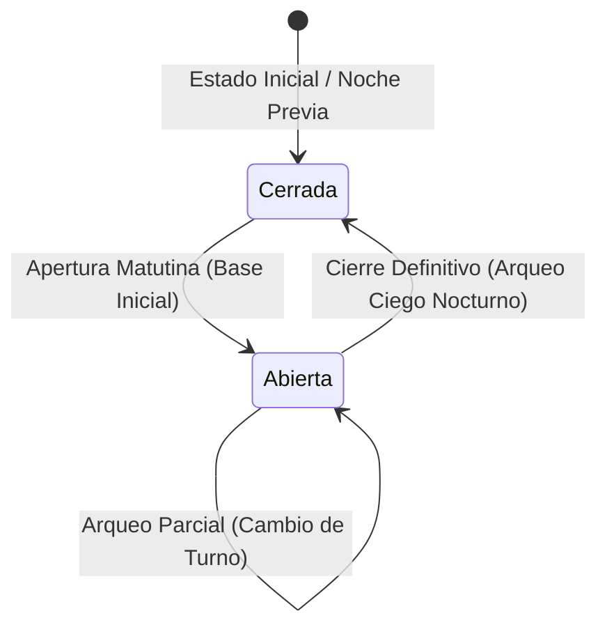

# Manual Técnico Fiabono — Capítulo 2: Caja Diaria, Turnos y Motor de Arqueo

> **Versión del Sistema:** Fiabono v1.0 (Producción)  
> **Propósito:** Documentación técnica de arquitectura, modelo de datos de Firestore, lógica de cálculo contable y especificaciones para el Agente de Soporte Inteligente (RAG).  
> **Ubicación en Código:** `utils/cierreCaja.ts`, `types/index.ts`, `app/dashboard/inicio/page.tsx`, `app/dashboard/historial/page.tsx`.

---

## 1. Arquitectura del Módulo de Caja

El módulo de caja no es una simple suma visual de transacciones; es un motor contable transaccional basado en eventos que administra el ciclo de vida del dinero físico y digital dentro del comercio.

### Ciclo de Estados de la Caja


---

## 2. Modelo de Datos Firestore: Colección `cierresCaja`

Cada apertura, arqueo de turno y cierre nocturno se persiste como un documento independiente en la colección `/cierresCaja/{cierreId}`.

### Estructura de Documento (TypeScript Interface)

```typescript
export type TipoRegistroCaja = 'apertura' | 'arqueo' | 'cierre';

export interface DesgloseDigitalesCierre {
  nequi: number;
  daviplata: number;
  bancolombia: number;
  datafono: number;
  transferencia: number;
  otros: number;
}

export interface CierreCaja {
  id?: string;
  usuarioId: string;              // UID del negocio principal (Tenant ID)
  tipoRegistro?: TipoRegistroCaja;// 'apertura' | 'arqueo' | 'cierre'
  cerradoPorUid: string;          // UID del cajero o admin que ejecutó la acción
  cerradoPorNombre: string;       // Nombre para visualización y auditoría
  fechaApertura?: Timestamp;      // Timestamp de inicio del turno
  fechaCierre: Timestamp;         // Timestamp del momento del arqueo/cierre
  
  // Balance Físico
  baseInicial: number;            // Dinero base con el que arrancó el turno
  ventasEfectivo: number;         // Cobros de contado en billetes/monedas
  abonosEfectivo: number;         // Recaudos de cartera en efectivo
  egresosEfectivo: number;        // Gastos de caja menor o retiros autorizados
  devolucionesEfectivo: number;   // Anulaciones o garantías reembolsadas
  totalEfectivoEsperado: number;  // Base + Ventas + Abonos - Egresos - Devoluciones
  totalEfectivoReal: number;      // Conteo manual del cajero (Calculadora de billetes)
  diferencia: number;             // totalEfectivoReal - totalEfectivoEsperado
  tipoDiferencia: 'exacto' | 'sobrante' | 'faltante' | 'pendiente';
  
  // Desglose Físico por Denominación COP
  desgloseDenominaciones?: {
    billetes100k?: number;
    billetes50k?: number;
    billetes20k?: number;
    billetes10k?: number;
    billetes5k?: number;
    billetes2k?: number;
    monedas1000?: number;
    monedas500?: number;
    monedas200?: number;
    monedas100?: number;
    monedas50?: number;
  };

  // Dinero en Bancos / Plataformas Digitales
  desgloseDigitales: DesgloseDigitalesCierre;
  totalVentasDigitales: number;
  
  // Consolidado General
  totalRecaudadoGeneral: number;  // Efectivo real + Total digitales
  totalTransacciones: number;
  notas?: string;

  // Auditoría Antifraude de Comprobantes Digitales
  vouchersVerificados?: boolean;
  vouchersAuditadosCount?: number;
  vouchersPendientesCount?: number;
  estadoAuditoriaDigital?: 'completo' | 'pendiente' | 'sin_digitales';
  
  creadoEn?: Timestamp;
}
```

---

## 3. Lógica de Cálculo y Fórmulas Contables (`utils/cierreCaja.ts`)

### 1. Determinación del Estado del Turno (`obtenerEstadoTurnoCaja`)
Para evitar que una apertura previa del día anterior confunda la caja:
1. Se consulta `collection(db, "cierresCaja")` donde `usuarioId == cuentaPrincipalId` ordenado por fecha desc.
2. Se extrae el último documento con `tipoRegistro === 'apertura'` y el último con `tipoRegistro === 'cierre'`.
3. **Condición de Caja Abierta:**
   $$\text{hora}(\text{UltimaApertura}) > \text{hora}(\text{UltimoCierre})$$
4. Si la caja está abierta, la ventana temporal del turno actual abarca desde `fechaApertura` hasta `new Date()`.

### 2. Ecuación Fundamental del Efectivo en Cajón
$$\text{Efectivo Esperado} = \text{Base Inicial} + \text{Ventas}_{\text{Efectivo}} + \text{Abonos}_{\text{Efectivo}} - \text{Egresos}_{\text{Efectivo}} - \text{Devoluciones}_{\text{Efectivo}}$$

### 3. Veredicto del Arqueo
$$\text{Diferencia} = \text{Efectivo Real (Conteo Físico)} - \text{Efectivo Esperado}$$

* Si $\text{Diferencia} == 0 \implies \textbf{exacto}$ (`Caja Cuadrada`).
* Si $\text{Diferencia} > 0 \implies \textbf{sobrante}$ (Hay más billetes en el cajón de lo registrado en sistema).
* Si $\text{Diferencia} < 0 \implies \textbf{faltante}$ (Falta dinero físico; posible pérdida o descuido).

---

## 4. Normalización de Medios de Pago Digitales

Para garantizar consistencia entre las distintas plataformas bancarias de Colombia, la función `normalizarMetodoPago(metodo, subMetodo, descripcion)` mapea cualquier entrada a las 6 claves canónicas:

| Entrada del Comerciante / POS | Clave Interna Firestore | Destino Contable |
| :--- | :--- | :--- |
| `nequi`, `nequi_qr`, `celular` | `nequi` | Banco Digital |
| `daviplata`, `davivienda_plata` | `daviplata` | Banco Digital |
| `bancolombia`, `transferencia_bancolombia`, `qr_bancolombia` | `bancolombia` | Cuenta de Ahorros |
| `datafono`, `tarjeta`, `credito`, `debito`, `pos_card` | `datafono` | Liquidación Adquirente |
| `pse`, `wompi`, `transferencia` | `transferencia` | Pasarela / Bancos |
| Cualquier otro medio digital | `otros` | Banco / Terceros |
| `efectivo`, `cash`, `monedas` | `efectivo` | Cajón Mostrador |

---

## 5. Reglas de Seguridad en Cloud Firestore (`firestore.rules`)

El acceso a la colección `cierresCaja` está protegido por las reglas de seguridad:
* **Lectura (`read`):** Permitida si `request.auth != null` y el usuario pertenece al tenant (`resource.data.usuarioId == request.auth.uid` o mediante el campo `adminId` del cajero).
* **Creación de Apertura/Cierre (`create`):**
  * Permitido al Dueño (`rol == 'admin'`).
  * Permitido a colaboradores si tienen activo el permiso:
    `request.auth.token.permisos.cierreCaja == true` o verificado en el documento de `usuarios`.
* **Modificación y Borrado (`update`, `delete`):**
  * **ESTRICTAMENTE BLOQUEADO:** Los cierres de caja son inmutables para garantizar el valor legal de la auditoría. No se pueden alterar los números una vez firmado el arqueo.

---

## 6. Base de Conocimiento para el Agente RAG (Preguntas y Diagnóstico)

### `Q-CAJA-01`: ¿Cómo responde el agente si el usuario reporta que su caja tiene un faltante?
* **Diagnóstico Sugerido por el Agente:**
  1. Pedirle al comerciante que revise en el **Historial de Movimientos** si se cobró una venta por transferencia (Nequi/Daviplata) pero en el sistema se marcó como "Efectivo".
  2. Preguntarle si hubo salidas de efectivo no registradas (gastos de almuerzo, proveedores de aseo o fletes).
  3. Indicarle que en Fiabono los arqueos admiten registrar el valor real contado para no falsear los libros contables.

### `Q-CAJA-02`: ¿Qué ocurre si un cajero intenta abrir caja dos veces el mismo día?
* **Lógica del Sistema:**
  El sistema detecta si ya existe una sesión abierta sin cierre previo. Le preguntará si desea realizar un arqueo intermedio de turno o si desea continuar con el turno activo.
