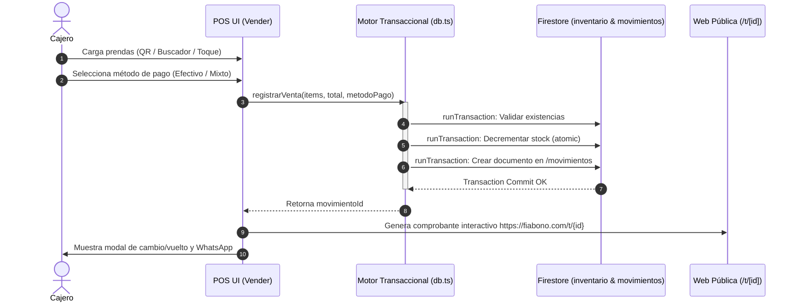

# Manual Técnico Fiabono — Capítulo 4: Punto de Venta (POS) y Movimientos Transaccionales

> **Versión del Sistema:** Fiabono v1.0 (Producción)  
> **Propósito:** Documentación técnica de arquitectura, modelo de datos de Firestore, reglas de concurrencia ACID, motor de pagos mixtos, tickets públicos y trazabilidad para el Agente RAG.  
> **Ubicación en Código:** `types/index.ts`, `servicios/db.ts`, `app/dashboard/vender/page.tsx`, `app/t/[id]/page.tsx`.

---

## 1. Arquitectura del Punto de Venta (POS)

El módulo POS permite la liquidación instantánea de órdenes de mostrador bajo tres modalidades:
1. **Venta Contado:** Salida de inventario + ingreso de dinero (Efectivo, Digital o Mixto).
2. **Venta a Crédito (Fiado):** Salida de inventario + creación de deuda en la ficha del cliente (con o sin anticipo).
3. **Venta Mixta / Compuesta:** Parte liquidada de contado y parte cargada a crédito.

### Flujo de la Transacción de Venta


---

## 2. Modelo de Datos Firestore: Colección `movimientos`

Ruta del documento: `/movimientos/{movimientoId}`

### Esquema del Documento (TypeScript Interface)

```typescript
export interface DetalleMovimiento {
  productoId?: string;
  nombre: string;
  cantidad: number;
  precioUnitario: number;
  subtotal: number;
  codigo?: string;
  talla?: string;
  color?: string;
  categoria?: string;
}

export interface Movimiento {
  id: string;                     // ID de la transacción
  usuarioId: string;              // Tenant ID del negocio
  clienteId?: string;             // ID del cliente en /clientes/{id} (opcional en mostrador)
  clienteNombre?: string;         // Nombre comercial para tickets
  tipo: 'venta' | 'fiado' | 'abono' | 'egreso' | 'entrega_separe' | 
        'ingreso_inventario' | 'devolucion' | 'cierre_caja' | 'anulacion';
  subtipo?: string;
  origen?: string;
  
  // Aspectos Financieros
  monto: number;                  // Valor neto cobrado / ingresado a caja
  valorMercancia?: number;        // Valor total de las prendas antes de descuentos
  subtotal?: number;              // Base imponible
  valorIva?: number;              // IVA calculado (si aplica)
  porcentajeIva?: number;
  
  // Descuentos
  descuentoTipo?: 'porcentaje' | 'fijo' | null;
  descuentoValor?: number;
  montoDescuento?: number;

  // Medios de Pago
  metodoPago?: 'efectivo' | 'nequi' | 'daviplata' | 'bancolombia' | 'datafono' | 'mixto' | 'saldo_a_favor';
  subMetodoPago?: string;
  referenciaPago?: string;        // Número de comprobante o aprobación bancaria
  montoEfectivo?: number;         // En pagos mixtos
  montoDigital?: number;          // En pagos mixtos

  // Ítems y Auditoría
  descripcion: string;            // Resumen de la venta (ej. "Blusa Seda x1, Jean Flare x1")
  detalles?: DetalleMovimiento[]; // Desglose completo de prendas
  registradoPor?: string;         // Nombre del colaborador / cajero
  registradoPorUid?: string;      // UID del operador
  fecha: Timestamp;               // Fecha/hora de servidor
  
  // Trazabilidad de Anulaciones
  anulado?: boolean;
  motivoAnulacion?: string;
  anuladoPor?: string;
  fechaAnulacion?: Timestamp;
  movimientoOrigenId?: string;    // Si es una devolución que reversa otra venta
}
```

---

## 3. Arquitectura del Recibo Público Digital (`/t/[id]`)

Para evitar depender exclusivamente de papel térmico, Fiabono genera para cada venta una **URL pública canónica**:
$$\text{URL Comprobante} = \text{https://fiabono.com/t/}\{\text{movimientoId}\}$$

### Características Técnicas del Endpoint `/t/[id]`
1. **Server-Side Rendering / Static Optimization con Next.js:** Carga en menos de 300 ms en cualquier conexión 3G o 4G móvil.
2. **Acceso Seguro Sin Autenticación:** El cliente final no necesita crear cuenta ni ingresar contraseñas; el `movimientoId` actúa como token criptográfico de consulta.
3. **Generación Dinámica de PDF:** Incluye botón de descarga de factura en PDF en el dispositivo del cliente.
4. **Metadatos OpenGraph (OG):** Al compartirse por WhatsApp, genera una tarjeta interactiva con el logo de la tienda, nombre del comercio y total de la compra.

---

## 4. Algoritmo de Pagos Mixtos y Cuadre de Caja

Cuando una venta se paga de forma combinada (ejemplo: Total `$100.000` = `$60.000` en Efectivo + `$40.000` en Nequi):
* El documento en `/movimientos` almacena:
  * `monto: 100000`
  * `metodoPago: "mixto"`
  * `montoEfectivo: 60000`
  * `montoDigital: 40000`
  * `subMetodoPago: "nequi"`
* El motor de arqueo en `utils/cierreCaja.ts`:
  * Suma exactamente `$60.000` al acumulador `ventasEfectivo` del cajón físico.
  * Suma exactamente `$40.000` a `desgloseDigitales.nequi` en bancos.

---

## 5. Base de Conocimiento para el Agente RAG (Preguntas y Diagnóstico)

### `Q-POS-01`: ¿Cómo responde el agente si un comerciante pregunta cómo compartir un recibo a un cliente que no tiene WhatsApp?
* **Respuesta del Agente:**
  El cajero puede tocar el botón de **Imprimir Ticket** para entregar una tirilla física en papel térmico (58mm u 80mm) o copiar el enlace directo `https://fiabono.com/t/{id}` para enviarlo por mensaje de texto SMS o correo electrónico.

### `Q-POS-02`: ¿Qué sucede si el cajero aplica un descuento por porcentaje y otro por valor fijo?
* **Lógica del Sistema:**
  El POS admite descuentos a nivel de ítem o a nivel de orden. Se calcula primero el valor bruto de la mercancía, se resta el monto del descuento y sobre el subtotal resultante se calcula el saldo final a cobrar.
