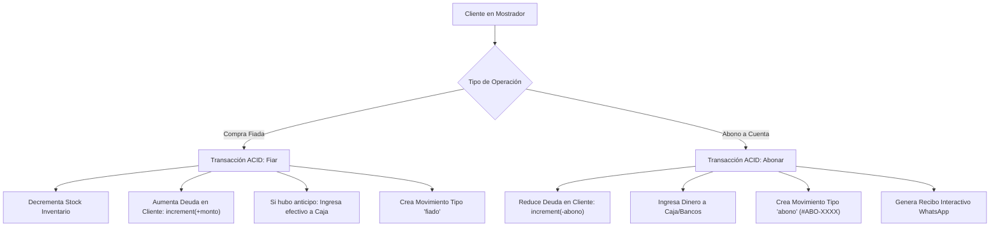

# Manual Técnico Fiabono — Capítulo 5: Módulo de Crédito, Cartera y Recaudos (Abonos)

> **Versión del Sistema:** Fiabono v1.0 (Producción)  
> **Propósito:** Documentación técnica de arquitectura, modelo de datos de Firestore, reglas de concurrencia ACID, saldo de clientes, pagarés y motor de cobranza para el Agente RAG.  
> **Ubicación en Código:** `types/index.ts`, `servicios/db.ts`, `app/dashboard/fiar/page.tsx`, `app/dashboard/abonar/page.tsx`, `utils/whatsapp.ts`.

---

## 1. Arquitectura del Módulo de Cartera

El crédito comercial en tiendas de barrio y comercios minoristas (tradicionalmente conocido como "Fiado") requiere un control estricto para evitar pérdidas. Fiabono implementa un **Libro Mayor de Cartera por Cliente**:



---

## 2. Modelo de Datos Firestore: Colección `clientes`

Ruta del documento: `/clientes/{clienteId}`

### Esquema del Documento (TypeScript Interface)

```typescript
export interface Cliente {
  id: string;                     // ID del cliente (o número de cédula/teléfono)
  usuarioId: string;              // Tenant ID del comercio
  nombre: string;                 // Nombre comercial o completo
  nombres?: string;
  apellidos?: string;
  celular: string;                // Teléfono móvil (10 dígitos en Colombia)
  deudaTotal: number;             // Saldo pendiente actual por cobrar en COP
  direccion?: string;             // Domicilio para cobranza
  notas?: string;                 // Observaciones o acuerdos de pago
  fecha_creacion: Timestamp;      // Fecha de registro en el sistema
  
  // Datos Tributarios (DIAN)
  tipoDocumento?: 'CC' | 'NIT' | 'CE' | 'PP' | string;
  numeroDocumento?: string;
  dv?: string;                    // Dígito de verificación para NIT
  email?: string;                 // Correo para facturación electrónica
  razonSocial?: string;
  
  // Clasificación Comercial
  etiquetas?: string[];           // Ej: ["Mayorista", "Puntual", "Vecino"]
  apodo?: string;                 // Sobrenombre para búsqueda rápida
}
```

---

## 3. Transacciones ACID de Fiado y Abono (`servicios/db.ts`)

### A. Otorgar Crédito (`fiar`)
La operación de fiar ejecuta una transacción de Firestore con 3 mutaciones atómicas:
1. **Verificación y Descuento de Stock:** Se decrementan las unidades del inventario con `increment(-cantidad)`.
2. **Actualización de Cartera:** Se incrementa la deuda acumulada del cliente:
   ```typescript
   transaction.update(clienteRef, {
     deudaTotal: increment(montoFiadoNeto),
     ultimoFiadoFecha: serverTimestamp()
   });
   ```
3. **Registro del Movimiento:** Se crea el documento en `/movimientos` con `tipo: 'fiado'` registrando el plazo acordado (8, 15 o 30 días) y el pagaré digital.

### B. Registrar Abono (`abonar`)
Cuando el cliente se acerca al mostrador a realizar un pago:
1. **Lectura Obligatoria:** Se obtiene el documento de `/clientes/{clienteId}` dentro de la transacción para verificar su `deudaTotal` actual.
2. **Amortización:** Se resta el monto pagado:
   ```typescript
   const deudaPrevia = Number(clienteDoc.data().deudaTotal || 0);
   const saldoRestante = Math.max(0, deudaPrevia - montoAbono);
   const saldoAFavor = montoAbono > deudaPrevia ? (montoAbono - deudaPrevia) : 0;

   transaction.update(clienteRef, {
     deudaTotal: saldoRestante,
     ...(saldoAFavor > 0 && { saldoAFavor: increment(saldoAFavor) }),
     ultimoAbonoFecha: serverTimestamp()
   });
   ```
3. **Ingreso a Caja:** El dinero se suma al arqueo del día en curso según el medio de pago (Efectivo o Banco digital).
4. **Comprobante Oficial:** Se emite el movimiento con código `#ABO-XXXX` y se despacha el enlace interactivo al WhatsApp del cliente.

---

## 4. Anulación y Reversión de Abonos

Si un cajero se equivoca y registra un abono de forma errónea:
1. Se invoca la función transaccional de anulación en `servicios/db.ts`.
2. **Reversión de Cartera:** La deuda del cliente vuelve a aumentar exactamente por el valor del abono:
   $$\text{deudaTotal} = \text{deudaTotal} + \text{montoAbono}$$
3. **Reversión de Caja:** El dinero se descuenta del arqueo de caja del turno actual.
4. El movimiento original queda marcado como `anulado: true` para fines de auditoría.

---

## 5. Base de Conocimiento para el Agente RAG (Preguntas y Diagnóstico)

### `Q-CAR-01`: ¿Cómo responde el agente si un comerciante pregunta qué ocurre si un cliente abona más de lo que debe?
* **Lógica del Sistema:**
  El sistema salda la deuda pendiente a `$0` y el excedente lo acredita como **Saldo a Favor** del cliente. En futuras compras o apartados, el comerciante podrá aplicar ese saldo a favor como método de pago (`saldo_a_favor`).

### `Q-CAR-02`: ¿Qué pasa si el cliente cambia de número de celular?
* **Procedimiento:**
  El comerciante puede ingresar a **`Clientes`**, seleccionar al cliente, tocar **`Editar`** y modificar el número de celular. Toda la deuda histórica y los recibos previos se conservan vinculados a su expediente sin sufrir alteraciones.
