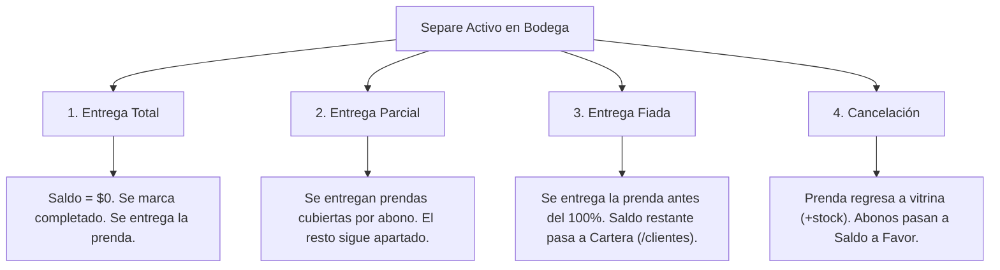

# Manual Técnico Fiabono — Capítulo 7: Plan Separe (Arquitectura de Apartados, Storage y Bodega)

> **Versión del Sistema:** Fiabono v1.0 (Producción)  
> **Propósito:** Documentación técnica de arquitectura, modelo de datos de Firestore, reglas de concurrencia ACID, gestión de archivos en Cloud Storage y los 4 flujos de liquidación para el Agente RAG.  
> **Ubicación en Código:** `types/index.ts`, `servicios/db.ts`, `app/dashboard/separe/page.tsx`, `app/dashboard/separes/page.tsx`, `storage.rules`.

---

## 1. Arquitectura del Módulo Plan Separe (Layaway)

El Plan Separe permite a un cliente reservar una o varias prendas mediante un anticipo monetario, congelando su precio y garantizando su disponibilidad mientras completa el pago en cuotas.

### Principios Técnicos Fundamentales
1. **Retención Física y Descuento Inmediato de Stock:** Tan pronto se crea el separe, las prendas se descuentan del stock visible de vitrina (`/inventario`) para impedir que otro cajero las venda.
2. **Ubicación en Bodega:** Cada ítem registra un campo de localización física (ej. *Caja 2, Estante B*) para que cualquier empleado pueda encontrar el paquete en el depósito.
3. **Respaldo Fotográfico en Cloud Storage:** Se captura una fotografía de la prenda con su etiqueta de precio y talla para blindar al comercio contra reclamos de cambio de color o referencia.
4. **Modo Liquidación (Plan Downgrade):** Si el comercio pasa del Plan PRO al Plan Básico/Comercio, los separes existentes **no se borran ni se congelan**; pasan a modo liquidación permitiendo recibir abonos y entregar prendas normalmente.

---

## 2. Modelo de Datos Firestore: Colección `separes`

Ruta del documento: `/separes/{separeId}`

### Esquema del Documento (TypeScript Interface)

```typescript
export type EstadoSepare = 'activo' | 'completado' | 'cancelado' | 'vencido' | 'entregado';

export interface ItemSepare {
  productoId?: string;
  nombre: string;
  cantidad: number;
  precioUnitario: number;
  subtotal: number;
  talla?: string;
  color?: string;
  ubicacionBodega?: string;        // Ej: "Estante 4, Bolsa 12"
  fotoUrl?: string;
}

export interface AbonoSepare {
  id: string;
  monto: number;
  fecha: Timestamp;
  metodoPago: string;
  registradoPor: string;
  referencia?: string;
}

export interface Separe {
  id: string;                      // ID autogenerado del separe
  usuarioId: string;               // Tenant ID del comercio
  creadoPor: string;               // Nombre del cajero o colaborador
  estado: EstadoSepare;
  
  // Cliente
  clienteId: string;
  clienteNombre: string;
  clienteCelular: string;

  // Financiero
  items: ItemSepare[];
  totalBruto: number;
  montoDescuento: number;
  total: number;                   // Valor final acordado
  montoPagado: number;             // Suma acumulada de todos los abonos
  saldoPendiente: number;          // total - montoPagado
  abonos: AbonoSepare[];

  // Evidencias y Bodega
  fotos: string[];                 // URLs públicas / autenticadas en Cloud Storage
  notas?: string;

  // Fechas y Vencimiento
  fechaCreacion: Timestamp;
  fechaLimite?: Timestamp | null;  // Fecha pactada para liquidación
  fechaCompletado?: Timestamp | null;
  fechaCancelado?: Timestamp | null;
  notaCancelacion?: string;
  montoPagadoAlCancelar?: number;
  idTransaccionCierre?: string;    // ID del movimiento generado en /movimientos
}
```

---

## 3. Arquitectura en Cloud Storage (`storage.rules`)

Las fotografías de las prendas de separe se almacenan en Google Cloud Storage bajo la estructura:
$$\text{Ruta Storage} = \text{/usuarios/}\{\text{tenantId}\}\text{/separes/}\{\text{separeId}\}\text{/}\{\text{timestamp}\}\text{.jpg}$$

### Reglas de Seguridad en Cloud Storage
* Tamaño máximo permitido: 5 MB por fotografía.
* Formatos válidos: `image/jpeg`, `image/png`, `image/webp`.
* Lectura autorizada al comercio titular y a los links públicos de comprobantes.
* Escritura restringida a usuarios autenticados con pertenencia al tenant.

---

## 4. Las 4 Vías de Salida de un Separe (`servicios/db.ts`)



### 1. Entrega Total (Liquidación 100%)
* El cliente paga el saldo pendiente restante (`saldoPendiente`).
* El dinero ingresa a la caja del turno actual.
* El documento se actualiza a `estado: 'completado'` y `fechaCompletado: serverTimestamp()`.

### 2. Entrega Parcial
* Si el cliente apartó 3 prendas y ha abonado el valor equivalente a 1 de ellas:
* Se entrega la prenda pagada y se actualiza el array `items` dejando en custodia las prendas restantes.

### 3. Entrega Fiada
* El cliente retira la prenda antes de completar el 100% del pago por acuerdo especial con el comerciante.
* En una transacción atómica:
  1. El separe se marca como `'entregado'` / `'completado'`.
  2. El `saldoPendiente` se transfiere a la ficha del cliente en `/clientes/{clienteId}`, incrementando su `deudaTotal`.
  3. Se genera un movimiento de tipo `'fiado'` por el monto faltante.

### 4. Cancelación de Separe
* Si el plazo vence o el cliente desiste:
  1. Las prendas reservadas **se reintegran al inventario** mediante `increment(+cantidad)`.
  2. El dinero abonado se acredita como **Saldo a Favor** en `/clientes/{clienteId}`.
  3. El separe pasa a `estado: 'cancelado'`.

---

## 5. Base de Conocimiento para el Agente RAG (Preguntas y Diagnóstico)

### `Q-SEP-01`: ¿Cómo responde el agente si el usuario pregunta si se puede modificar la fecha límite de un separe?
* **Respuesta:**
  Sí. El comerciante o administrador puede ingresar a **`Separes`**, abrir el separe activo, tocar **`Editar`** y seleccionar una nueva fecha en el calendario para concederle un plazo adicional al comprador.

### `Q-SEP-02`: ¿Qué pasa con las prendas si un separe se vence?
* **Lógica del Sistema:**
  El sistema NO libera automáticamente la prenda a vitrina el día del vencimiento para evitar desarmar el paquete si el cliente llega tarde. La prenda permanece retenida en bodega hasta que el comerciante toque explícitamente el botón **`Cancelar Separe`**.
