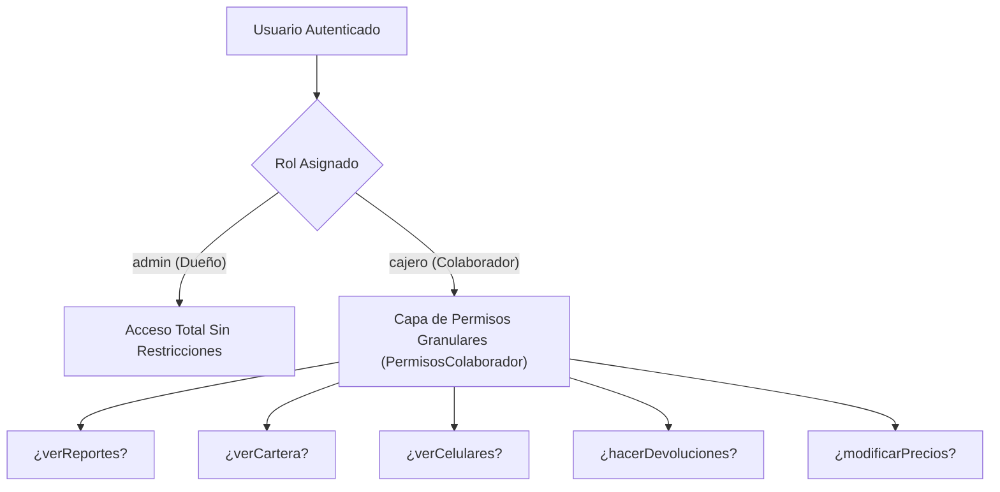

# Manual Técnico Fiabono — Capítulo 10: Analítica Financiera, Seguridad y Matriz de Permisos RBAC

> **Versión del Sistema:** Fiabono v1.0 (Producción)  
> **Propósito:** Documentación técnica de arquitectura, motor de cálculo de márgenes, algoritmos de reporte y matriz de seguridad basada en roles (RBAC) para el Agente RAG.  
> **Ubicación en Código:** `types/index.ts`, `app/dashboard/reportes/page.tsx`, `servicios/exportadorReportes.ts`, `app/dashboard/perfil/page.tsx`, `firestore.rules`.

---

## 1. Arquitectura de Analítica Financiera

A diferencia de los puntos de venta genéricos que solo suman transacciones brutas, el motor de analítica de Fiabono calcula en tiempo real la **Rentabilidad Operativa Neta**:

$$\text{Utilidad Neta Real} = \sum (\text{Precio Venta} - \text{Costo Unitario}) - \text{Descuentos}$$
$$\text{Margen Bruto (\%)} = \left( \frac{\text{Utilidad Neta}}{\text{Ventas Brutas}} \right) \times 100$$

### Algoritmo de Agregación (`app/dashboard/reportes/page.tsx`)
1. **Filtro de Exclusión:** Se descartan automáticamente los movimientos con `anulado === true` para no inflar métricas contables.
2. **Segmentación Temporal Segura:** Un helper `obtenerFechaJS()` normaliza timestamps de Firestore (`Timestamp.seconds`), strings ISO y objetos `Date`.
3. **Cálculo de Caja Neta:**
   $$\text{Caja Neta} = \text{Ventas Contado} + \text{Abonos Cartera} + \text{Anticipos Separe}$$

---

## 2. Generador de Reportes Contables (`servicios/exportadorReportes.ts`)

Fiabono exporta la información en dos formatos estándar:
* **Hojas de Cálculo XLSX (Excel):** Generadas en el navegador mediante la librería `xlsx`, con pestañas separadas para:
  1. *Resumen Ejecutivo:* Totales de caja, ventas, costos y utilidades.
  2. *Detalle de Ventas:* Cada prenda vendida con SKU, cliente, medio de pago y vendedor.
  3. *Cartera Pendiente:* Listado de deudores, días de mora y teléfonos.
* **Informes PDF Ejecutivos:** Documentos formalmente maquetados con encabezado membretado del negocio, logotipo, fecha de corte y tablas financieras con numeración.

---

## 3. Matriz de Seguridad y Roles (RBAC)

Fiabono implementa un control de acceso multi-inquilino (*Multi-Tenant*) donde cada negocio opera en un espacio de datos estrictamente aislado:

### Desglose Exhaustivo de Permisos (`PermisosColaborador`)

| Permiso Técnico | Tipo | Impacto en Interfaz y API | Nivel de Riesgo |
| :--- | :---: | :--- | :---: |
| `verReportes` | `boolean` | Oculta la ruta `/dashboard/reportes` y las utilidades. | 🔴 Alto |
| `verCartera` | `boolean` | Controla acceso a `/dashboard/clientes` y saldos deudores. | 🟡 Medio |
| `verCelulares` | `boolean` | Enmascara teléfonos de clientes (`315 *** **24`) para evitar fugas de base de datos. | 🔴 Alto |
| `hacerDevoluciones` | `boolean` | Habilita botón de anular ventas y reversar dinero de caja. | 🔴 Crítico |
| `modificarPrecios` | `boolean` | Permite cambiar el precio unitario en mostrador al cobrar. | 🟡 Medio |
| `aplicarDescuentos` | `boolean` | Permite aplicar rebajas en `%` o `$` al carrito. | 🟡 Medio |
| `cierreCaja` | `boolean` | Autoriza realizar arqueos y cierres de turno. | 🟡 Medio |
| `editarInventario` | `boolean` | Permite crear, modificar o eliminar productos en catálogo. | 🟡 Medio |
| `ingresoInventario` | `boolean` | Permite cargar compras a proveedores y subir stock. | 🟢 Bajo |
| `ventaDirecta` | `boolean` | Habilita cobros de contado y generación de fiados. | 🟢 Operativo |
| `abonar` | `boolean` | Permite registrar recaudos de dinero a crédito. | 🟢 Operativo |
| `planSepare` | `boolean` | Permite crear apartados y entregas en bodega. | 🟢 Operativo |
| `enviarWhatsApp` | `boolean` | Habilita compartir tickets por WhatsApp. | 🟢 Operativo |
| `ventaLibre` | `boolean` | Permite cobrar ítems manuales sin SKU en inventario. | 🟡 Medio |
| `terminalMultivendedor` | `boolean` | Permite alternar vendedores en una misma terminal física. | 🟢 Operativo |

---

## 4. Acceso Sin Correo Personal: Identificador de Tienda (`slug`)

Para facilitar el ingreso de empleados de mostrador sin requerir cuentas de Google ni correos personales:
1. El negocio tiene un identificador único: `slugNegocio` (ej. `tiendasanpedro`).
2. El colaborador se autentica con:
   * **Tienda:** `tiendasanpedro`
   * **Usuario:** `andres`
   * **Contraseña:** `******`
3. El backend resuelve el documento en `/usuarios` vinculando al colaborador con el `cuentaPrincipalId` del comercio.

---

## 5. Base de Conocimiento para el Agente RAG (Preguntas y Diagnóstico)

### `Q-SEG-01`: ¿Cómo responde el agente si un comerciante pregunta cómo evitar que un cajero se robe la base de datos de clientes?
* **Instrucción del Agente:**
  Indicarle al dueño que vaya a **`Perfil > Colaboradores`**, edite el usuario del cajero y **desactive el interruptor `Ver Celulares`**. A partir de ese momento, todos los números de teléfono se mostrarán enmascarados con asteriscos (`310 *** **99`), impidiendo que el empleado copie o exporte los contactos de sus clientes.

### `Q-SEG-02`: ¿Qué sucede si un cajero sin permiso de devoluciones intenta anular una venta?
* **Comportamiento del Sistema:**
  El botón de anulación aparecerá oculto o bloqueado con candado en el Historial. Si intentara enviar una petición directa a Firestore, la regla de seguridad `firestore.rules` rechazará la operación con un error de permisos denegados (`permission-denied`).
