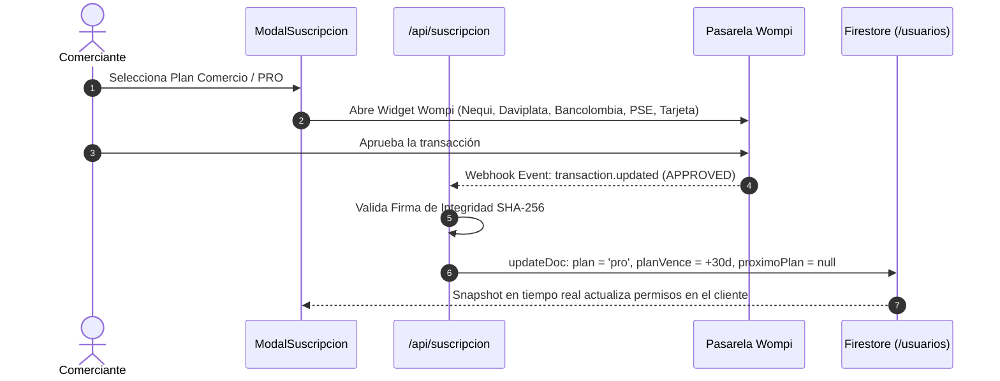

# Manual Técnico Fiabono — Capítulo 12: Pasarela Wompi y Facturación Electrónica DIAN (UBL 2.1)

> **Versión del Sistema:** Fiabono v1.0 (Producción)  
> **Propósito:** Documentación técnica de arquitectura, integración de pagos recurrentes Wompi y motor de emisión tributaria DIAN (UBL 2.1) para el Agente RAG.  
> **Ubicación en Código:** `servicios/facturacionDian.ts`, `app/api/suscripcion/`, `components/ModalSuscripcion.tsx`.

---

## 1. Arquitectura de Suscripciones y Pagos (Wompi)

Fiabono gestiona el cobro de membresías comerciales y la activación de planes PRO mediante la pasarela colombiana **Wompi** (Grupo Bancolombia):



### Firma de Integridad SHA-256 de Wompi
Para evitar ataques de falsificación de pagos, cada evento de webhook se valida contra el secreto de eventos de Wompi:
$$\text{Firma Calculada} = \text{SHA256}(\text{transactionId} + \text{status} + \text{amountInCents} + \text{timestamp} + \text{eventSecret})$$

---

## 2. Motor de Facturación Electrónica DIAN (UBL 2.1)

El archivo `servicios/facturacionDian.ts` implementa la especificación técnica exigida por la DIAN en Colombia para facturación electrónica y notas crédito bajo el estándar **UBL 2.1**.

### A. Mapeo de Medios de Pago al Estándar DIAN
La función `mapearMedioPagoDian(metodo)` traduce las formas de pago del mostrador a los códigos oficiales del anexo técnico:

| Medio en Fiabono | Payment Method ID | Means Payment ID | Descripción Oficial DIAN |
| :--- | :---: | :---: | :--- |
| `efectivo` | `1` (Contado) | `10` | Efectivo |
| `nequi` / `daviplata` | `1` (Contado) | `47` | Transferencia Débito Bancaria |
| `bancolombia` | `1` (Contado) | `47` | Transferencia Débito Bancaria |
| `datafono` (Crédito) | `1` (Contado) | `48` | Tarjeta de Crédito |
| `datafono` (Débito) | `1` (Contado) | `49` | Tarjeta de Débito |
| `fiado` | `2` (Crédito) | `10` | Instrumento no definido / Acuerdo a plazos |

---

## 3. Construcción del Payload DIAN (`construirPayloadFacturaUbl21`)

El objeto JSON enviado al proveedor tecnológico MATIAS API contiene:

```typescript
export interface ParametrosEmisionFactura {
  movimiento: Movimiento;
  cliente?: Partial<Cliente> | null;
  resolucion?: string;             // Número de resolución DIAN autorizada
  prefijo?: string;                // Prefijo asignado (ej: "FE", "SETT")
  consecutivo: number;             // Número consecutivo de la factura
}
```

### 1. Consumidor Final Estándar
Si la venta fue a un transeúnte de mostrador sin datos tributarios:
* Documento: `222222222222`
* Tipo de Documento: Cédula de Ciudadanía (`identity_document_id: 1`)
* Nombre: `Consumidor Final`
* Tipo de Organización: Persona Natural (`type_organization_id: 2`)

### 2. Cliente Formal con NIT / Cédula
Si el cliente suministró sus datos de empresa:
* Cédula (`identity_document_id: 1`) o NIT (`identity_document_id: 3`).
* Cálculo automático del Dígito de Verificación (DV).
* `type_organization_id: 1` (Persona Jurídica) o `2` (Persona Natural).

---

## 4. Validación Criptográfica: CUFE, CUDE y Código QR

Una vez MATIAS API y la DIAN aprueban el documento XML:
1. **CUFE (Código Único de Facturación Electrónica):** Se genera mediante el algoritmo criptográfico SHA-384 encadenando los valores de la factura y la clave técnica de la DIAN.
2. **Código QR Reglamentario:** URL oficial que apunta al portal de consulta de la DIAN (`catalogo-vpfe.dian.gov.co`).
3. **Persistencia:** El CUFE y el QR se almacenan en el documento del movimiento para que el ticket térmico o el comprobante web `/t/[id]` muestren los elementos legales de inmediato.

---

## 5. Emisión de Notas Crédito Electrónicas (`emitirNotaCreditoDian`)

Cuando se anula una venta que ya había sido reportada ante la DIAN:
* No se borra la factura original.
* Se emite una **Nota Crédito Electrónica** que referencia directamente el **CUFE original**:
  ```typescript
  billing_reference: {
    number: feOriginal.consecutivoFactura,
    uuid: feOriginal.cufe,
    issue_date: feOriginal.fechaEmision
  }
  ```
* La nota crédito genera su propio **CUDE (Código Único de Documento Electrónico)** y anula el efecto impositivo de la venta.

---

## 6. Base de Conocimiento para el Agente RAG (Preguntas y Diagnóstico)

### `Q-DIAN-01`: ¿Cómo responde el agente si un cliente exige una factura electrónica pero la tienda no está obligada a facturar?
* **Respuesta:**
  Si el comercio opera bajo el régimen no responsable de IVA (antiguo simplificado), el ticket de Fiabono actúa como documento soporte de venta física válido. Si el comprador requiere factura electrónica formal para deducir costos en su declaración de renta, el comerciante puede habilitar el módulo DIAN en Fiabono o emitir una cuenta de cobro / documento equivalente según su régimen.

### `Q-DIAN-02`: ¿Por qué una factura electrónica fue rechazada por la DIAN?
* **Diagnóstico Sugerido:**
  1. Verificar si el NIT del comprador tiene un Dígito de Verificación erróneo.
  2. Verificar si la resolución de facturación DIAN ya alcanzó su fecha de vencimiento o agotó el rango de numeración autorizado.
