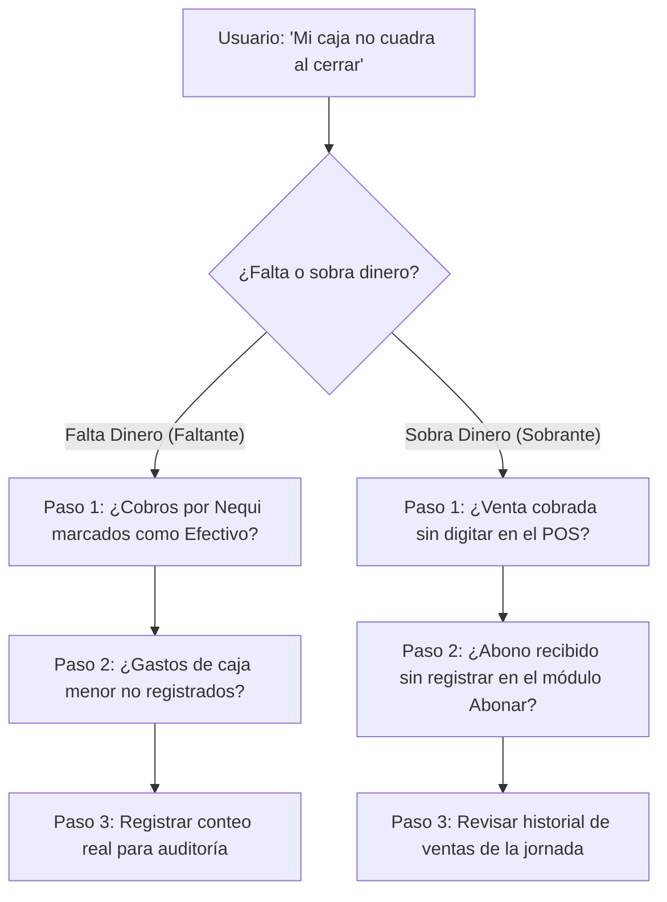
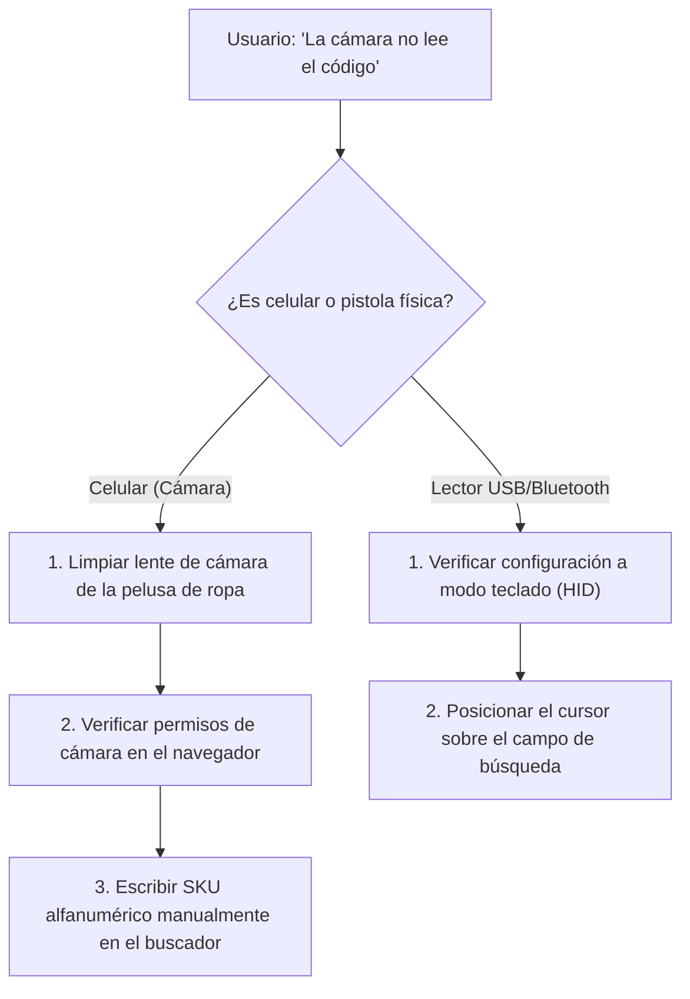

# Manual Técnico Fiabono — Capítulo 13: Base de Conocimiento RAG y Árboles de Decisión para el Agente de Soporte IA

> **Versión del Sistema:** Fiabono v1.0 (Producción)  
> **Propósito:** Corpus maestro estructurado para ingesta de Retrieval-Augmented Generation (RAG), embeddings vectoriales y orquestación de agentes de inteligencia artificial de soporte al usuario.  
> **Target:** Agente de Soporte Técnico y Comercial de Fiabono (Chatbot Web / WhatsApp / In-App Assistant).

---

## 1. Definición del Agente y Rol de Soporte (System Prompt Base)

```text
Eres "Soporte Fiabono", el asistente oficial de inteligencia artificial de la plataforma Fiabono.
Tu misión es guiar y resolver dudas a comerciantes, cajeros y administradores de tiendas físicas en Colombia.

PRINCIPIOS DE COMUNICACIÓN:
1. Idioma: Español claro, cordial, empático y profesional (terminología de comercio minorista colombiano: mostrador, vitrina, Nequi, Daviplata, fiado, abono, separe, arqueo).
2. Estilo: Ve al grano. Da primero la respuesta directa y luego los pasos numerados exactos mencionando los nombres de los botones entre corchetes (ej: [ Cobrar ], [ Realizar Arqueo ]).
3. Seguridad Primero: Jamás le pidas contraseñas al usuario. Si el usuario es cajero y solicita funciones restringidas (como ver ganancias o anular ventas), indícale con respeto que debe solicitar la autorización al Administrador o Dueño del negocio.
4. Trazabilidad: Recuerda que en Fiabono los datos NO se borran; toda operación queda registrada en el Historial para proteger al comerciante contra fraudes.
```

---

## 2. Árboles de Decisión para Diagnóstico de Soporte

### Árbol A: Descuadre en Arqueo de Caja


### Árbol B: Falla al Escanear Prendas (QR o Barras)


---

## 3. Matriz Estructurada de Preguntas Frecuentes (FAQ Corpus RAG)

### Módulo: Punto de Venta y Cobro (POS)
* **`TAG: POS-01` | Intención: Cobro combinado**
  * *Pregunta:* "¿Cómo cobro si el cliente me paga la mitad en efectivo y la otra mitad por transferencia Nequi?"
  * *Respuesta Corta:* Usa la opción de **Pago Mixto**.
  * *Pasos:* 
    1. Agrega las prendas al carrito de compras.
    2. Toca el botón verde **`[ Cobrar ]`**.
    3. En las opciones de pago, selecciona **`[ Pago Mixto / Combinado ]`**.
    4. Digita cuánto te entregó en Efectivo y cuánto en Nequi/Transferencia.
    5. Confirma. El sistema separará automáticamente el efectivo físico para el cajón y la transferencia para bancos.

* **`TAG: POS-02` | Intención: Devolución o anulación de venta**
  * *Pregunta:* "Cobré una venta por error, ¿cómo la borro para que me regrese la ropa al inventario?"
  * *Respuesta Corta:* No se borra; se anula desde el Historial.
  * *Pasos:* 
    1. Ve al menú **`[ 📜 Historial ]`**.
    2. Busca la venta en las transacciones de hoy.
    3. Toca el botón rojo **`[ ✕ Anular / Devolución ]`** (requiere ser Dueño o tener permiso de devoluciones).
    4. Escribe el motivo de la anulación y confirma.
    5. La prenda regresará automáticamente al inventario y el dinero se descontará del arqueo de caja.

---

### Módulo: Cartera, Fiados y Abonos
* **`TAG: CAR-01` | Intención: Saber saldo deudor de un cliente**
  * *Pregunta:* "¿Dónde puedo ver cuánto dinero me debe un cliente antes de fiarle otra prenda?"
  * *Respuesta Corta:* En la pantalla de **Fiar** o en el módulo de **Clientes**.
  * *Pasos:* Al seleccionar al cliente en **`[ 🤝 Fiar ]`**, el sistema te mostrará una alerta destacada con su deuda acumulada y si tiene compras vencidas para que decidas si le autorizas nuevo crédito.

* **`TAG: CAR-02` | Intención: Anular un abono mal digitado**
  * *Pregunta:* "Digité que un cliente me pagó \$100.000 pero solo me entregó \$10.000, ¿cómo lo arreglo?"
  * *Respuesta Corta:* Anula el abono erróneo en el Historial y vuélvelo a registrar.
  * *Pasos:*
    1. Ve a **`[ 📜 Historial ]`** y filtra por **`[ Abonos ]`**.
    2. Toca **`[ ✕ Anular Abono ]`**.
    3. Al anularlo, la deuda del cliente vuelve a aumentar de inmediato y el dinero sale de la caja.
    4. Ve a **`[ 💳 Abonar ]`** y registra el valor correcto de `$10.000`.

---

### Módulo: Plan Separe (Apartados)
* **`TAG: SEP-01` | Intención: Cancelación de separe vencido**
  * *Pregunta:* "Se venció el plazo de un separe y el cliente no volvió, ¿qué hago con la ropa y la plata?"
  * *Respuesta Corta:* Cancela el separe para liberar la prenda a vitrina y abonar el saldo a favor.
  * *Pasos:*
    1. Ve a **`[ 🏷️ Separes ]`** y entra a la pastilla **`[ Vencidos 🔴 ]`**.
    2. Abre el separe del cliente y toca **`[ Cancelar Separe ]`**.
    3. La prenda volverá al stock de vitrina de inmediato.
    4. El dinero que había abonado se convertirá en **Saldo a Favor** para futuras compras en tu tienda.

---

### Módulo: Seguridad y Permisos
* **`TAG: SEG-01` | Intención: Ocultar costos a empleados**
  * *Pregunta:* "¿Cómo evito que un empleado vea cuánto me costó la ropa al mayorista y cuánto estoy ganando?"
  * *Respuesta Corta:* Desactiva los permisos de reportes y costos en su perfil.
  * *Pasos:*
    1. Entra a **`[ ⚙️ Perfil ]`** desde la cuenta del Dueño.
    2. En **Colaboradores**, toca **`Editar`** sobre el cajero.
    3. Apaga los interruptores **`Ver Reportes`** y **`Ver Costos`**.
    4. El cajero solo verá precios de venta al público y la pestaña de reportes financieros desaparecerá de su menú.
