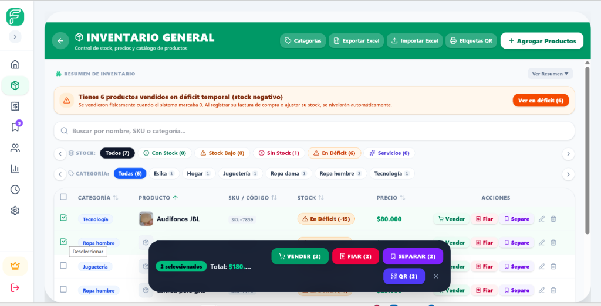
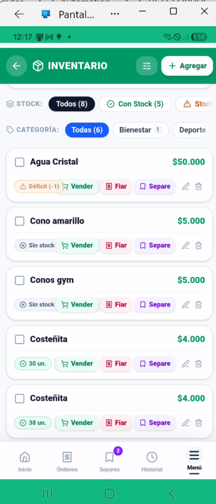

# Guía Oficial del Comerciante — Capítulo 0: Bienvenido a Fiabono y Mapa de la Pantalla

> **Manual de Operaciones para el Usuario Final**  
> **Aplica para:** Propietarios de Negocio, Administradores, Cajeros y Vendedores de Mostrador.  
> **Lectura estimada:** 9 minutos.

---

## 1. ¡Bienvenido a Fiabono! La Nueva Era de tu Negocio 🎉

Si estás leyendo esta guía, acabas de dar el paso más importante para modernizar y hacer crecer tu comercio: **despedirte para siempre de los cuadernos de hojas arrancadas, las cuentas con tachones a lápiz y la incertidumbre de no saber cuánto dinero ganaste en el día**.

### ¿Qué hace Fiabono por ti todos los días?
* **Cobras en 3 segundos:** Escaneas con la cámara de tu celular o buscas por nombre, y el cobro queda registrado al instante.
* **Cuentas 100% claras:** Sabes exactamente cuánto dinero entró en efectivo, cuánto por transferencias (Nequi/Daviplata) y cuánto te deben los clientes de fiado.
* **Cero discusiones con tus clientes:** Cada venta, crédito o abono genera un recibo digital formal que se envía directo a su WhatsApp con un solo toque.
* **Control total desde donde estés:** Si estás fuera de tu local o viajando, abres Fiabono en tu celular y ves en tiempo real cada venta que tus empleados registran en el mostrador.

---

## 2. Cómo Acceder e Instalar Fiabono en tus Dispositivos (Paso a Paso)

Fiabono está diseñado como una **Plataforma Multidispositivo en la Nube**. Esto significa que puedes utilizarlo en tu computador de caja, en tu teléfono personal y en los celulares de tus vendedores simultáneamente, manteniendo la información sincronizada al instante.

A continuación tienes el paso a paso exacto para cada uno de tus dispositivos:

---

### 2.1. En Computadores de Escritorio y Portátiles (Windows y Mac)

Puedes utilizar Fiabono como una página web tradicional o instalarlo como un **programa de escritorio** con su propio icono en la barra de tareas de Windows.

```
┌────────────────────────────────────────────────────────────────────────┐
│  PASO A PASO: INSTALACIÓN EN PC CON GOOGLE CHROME O MICROSOFT EDGE     │
├────────────────────────────────────────────────────────────────────────┤
│  Paso 1: Abre tu navegador web favorito (Google Chrome o Edge).        │
│  Paso 2: En la barra de direcciones escribe: fiabono.com               │
│  Paso 3: Inicia sesión con tu correo y contraseña.                    │
│  Paso 4: Mira el extremo derecho de la barra de direcciones (donde     │
│          está la estrella de favoritos). Verás un icono con un cuadro   │
│          y una flechita hacia abajo o un signo más: [ ⊕ Instalar ].    │
│  Paso 5: Haz clic en [ Instalar Fiabono ].                             │
│  Paso 6: Se abrirá una ventana limpia independiente (sin pestañas      │
│          ni barras de navegador).                                      │
│  Paso 7: Haz clic derecho sobre el icono de Fiabono en tu barra de     │
│          tareas de Windows y selecciona: "Anclar a la barra de tareas". │
└────────────────────────────────────────────────────────────────────────┘
```

> 💡 **Consejo de Pantalla Completa (Modo Kiosco):**  
> Cuando atiendas en tu computador, presiona la tecla **F11** en tu teclado. Fiabono ocupará toda la pantalla de tu monitor, luciendo idéntico a una caja registradora profesional de supermercado. Presiona **F11** nuevamente cuando quieras salir.

---

### 2.2. En Teléfonos iPhone y Tablets iPad (Apple iOS / iPadOS)

En los dispositivos de Apple, la instalación se realiza a través de la tecnología oficial de aplicaciones web de Safari. No necesitas pagar nada ni buscar en la App Store.

```
┌────────────────────────────────────────────────────────────────────────┐
│  PASO A PASO: INSTALACIÓN EN IPHONE O IPAD                             │
├────────────────────────────────────────────────────────────────────────┤
│  ⚠️ IMPORTANTE: Este proceso DEBE realizarse desde el navegador         │
│     SAFARI (el icono azul de la brújula). No uses Google Chrome en iOS │
│     para la instalación inicial porque Apple solo permite agregar a    │
│     la pantalla de inicio desde Safari.                                │
│                                                                        │
│  Paso 1: Abre SAFARI en tu iPhone o iPad.                              │
│  Paso 2: Escribe en la barra de búsqueda: fiabono.com e ingresa.      │
│  Paso 3: Inicia sesión con tus datos de comercio.                      │
│  Paso 4: En la parte inferior de la pantalla de tu iPhone, busca el    │
│          botón COMPARTIR (es un cuadro con una flecha hacia arriba ↑).  │
│  Paso 5: Al tocarlo, se abrirá un menú blanco con varias opciones.     │
│          Desliza el dedo hacia abajo hasta encontrar la opción:        │
│          [ ➕ Agregar al inicio ] (o "Add to Home Screen").             │
│  Paso 6: Te aparecerá una confirmación con el logo de Fiabono y el     │
│          nombre. Toca en la esquina superior derecha: [ Agregar ].     │
│  Paso 7: ¡Listo! Vuelve a tu pantalla de inicio y verás el icono de   │
│          Fiabono junto a tus demás aplicaciones.                       │
└────────────────────────────────────────────────────────────────────────┘
```

> 💡 **La ventaja en iPhone:**  
> Al abrir Fiabono desde el icono que acabas de crear, la aplicación se abre en **pantalla completa**, sin la barra superior ni inferior de Safari, brindándote la experiencia fluida de una app nativa.

---

### 2.3. En Teléfonos y Tablets Android (Samsung, Xiaomi, Motorola, etc.)

En celulares Android tienes dos formas muy sencillas de tener la aplicación lista:

#### Método A: Con el Mensaje Automático
1. Abre **Google Chrome** en tu teléfono Android y entra a `fiabono.com`.
2. Al iniciar sesión, verás un mensaje flotante en la parte inferior que dice:  
   *¿Deseas agregar Fiabono a tu pantalla principal?*
3. Toca el botón verde **[ Instalar ]** o **[ Agregar ]**.
4. En 2 segundos el icono aparecerá en tu menú de aplicaciones.

#### Método B: Desde el Menú de Chrome (Si no viste el mensaje)
1. En Google Chrome, entra a `fiabono.com`.
2. Toca los **tres puntos verticales (`⋮`)** ubicados en la esquina superior derecha.
3. En el menú desplegable, toca la opción **"Instalar aplicación"** o **"Agregar a la pantalla principal"**.
4. Confirma tocando **[ Instalar ]**.

---

### 2.4. ¿Por qué esta tecnología es mejor que una descarga tradicional?

Muchos comerciantes nos preguntan: *¿Por qué no tengo que descargarla obligatoriamente desde la Google Play Store o App Store?*

1. **Cero Espacio en Memoria:** Las aplicaciones de tienda suelen pesar 80 o 150 Megabytes y llenan la memoria de los teléfonos de tus empleados. Fiabono es ultra liviano y no satura el celular.
2. **Actualizaciones Instantáneas:** Cada vez que lanzamos una mejora en el sistema, no tienes que entrar a la tienda a actualizar nada. Solo abres la app y ya tienes la última versión funcionando.
3. **Funciona en cualquier marca y gama:** Desde un teléfono económico de entrada hasta el último modelo de gama alta.

---

## 3. Tu Cabina de Mando: El Mapa de la Pantalla

Para que nunca te sientas perdido, la pantalla de Fiabono está organizada de forma limpia, pensada para que manejes todo con una sola mano desde tu teléfono o cómodamente desde tu computador.


*Figura 0.1: Distribución ergonómica de Fiabono en un teléfono celular con dock inferior flotante.*

---

### 3.1. La Barra Superior (Encabezado)
Ubicada en la parte más alta de la pantalla, te muestra la información vital de tu negocio en todo momento:
1. **Logo y Nombre de tu Local:** Te recuerda en qué tienda estás ubicado.
2. **Estado de Caja en Vivo:** Te muestra con un punto de color si la caja del día está abierta (verde) o cerrada (gris/rojo).
3. **Campana de Notificaciones:** Te avisa cuando entra una orden nueva de preventa o cuando hay un recordatorio pendiente.
4. **Foto de Perfil:** Te permite entrar a tus ajustes, cambiar de tema (claro u oscuro) o cerrar sesión de forma segura.

---

### 3.2. El Menú Inferior Flotante (Tu Barra de Acceso Rápido en Celulares)
En la parte baja de tu teléfono encontrarás un dock flotante tipo cápsula con los botones principales:

* 🏠 **Inicio:** Tu pantalla principal. Aquí ves el total vendido en el día, los cobros pendientes y el buscador de clientes.
* 📦 **Inventario:** Tu catálogo de productos. Aquí agregas ropa, calzado, comida o tecnología, cambias precios, imprimes etiquetas y controlas cuántas unidades te quedan.
* 🛒 **Vender:** Tu caja registradora. Es la pantalla donde pasas los productos, seleccionas cómo paga el cliente (Efectivo, Nequi, Tarjeta) y emites el recibo.
* 🔖 **Separes:** El módulo de apartados. Donde controlas las prendas que tus clientes reservaron con un anticipo y cuándo vence el plazo de entrega.
* 🕒 **Historial:** La bitácora transparente. Cada venta, abono o anulación queda registrada con fecha, hora y el nombre de quién atendió.


*Figura 0.2: En pantallas grandes de computador o tablet, el menú se despliega lateralmente a la izquierda con mayor espacio de trabajo.*

---

## 4. ¿Quién manda en el negocio? El Dueño vs. Los Empleados

Una de las mayores preocupaciones de un comerciante es: *¿Mis empleados van a ver cuánto me cuesta la mercancía o cuánta ganancia me queda al mes?*

**La respuesta es un rotundo NO.** Fiabono tiene una separación total entre el Dueño y los Cajeros:

| Función en el Negocio | Vista del Dueño (Tú) | Vista de tus Empleados / Cajeros |
| :--- | :---: | :---: |
| **Cobrar ventas en mostrador** | ✅ Sí | ✅ Sí |
| **Buscar clientes y registrar abonos** | ✅ Sí | ✅ Sí (si le das permiso) |
| **Ver ganancias netas y utilidades** | ✅ **Totalmente visible** | 🔒 **Oculto bajo candado** |
| **Ver costo de compra a proveedores** | ✅ **Totalmente visible** | 🔒 **Oculto bajo candado** |
| **Anular ventas o borrar registros** | ✅ **Solo el dueño** | 🚫 **Bloqueado contra fraude** |
| **Modificar precios en el mostrador** | ✅ Sí | 🔒 Bloqueado (vende al precio fijado) |
| **Descargar bases de datos en Excel** | ✅ Sí | 🚫 Bloqueado para evitar robo de datos |

> ⚠️ **Atención y Seguridad:**  
> Nunca le des tu correo y contraseña personal a tus empleados. En el **Capítulo 11** aprenderás cómo crearle a cada cajero su propio usuario con su nombre y los permisos justos que tú decidas.

---

## 5. Diccionario de Mostrador (Glosario fácil y sin enredos)

Para hablar el mismo idioma a lo largo de este manual, estos son los 5 conceptos clave de tu día a día:

1. **Venta de Contado:**  
   El cliente te compra, te paga el 100% del dinero en el momento (sea en efectivo, transferencia o tarjeta) y se lleva su mercancía inmediatamente.
2. **Fiado (Crédito de Confianza):**  
   El cliente se lleva los productos hoy, pero te los paga después (en 8 días, en la quincena o en cuotas). El sistema le abre una cuenta por cobrar digital y te avisa cuando entre en mora.
3. **Plan Separe (Apartado):**  
   El cliente quiere una prenda o artículo pero no tiene todo el dinero. Te entrega un valor inicial (anticipo). **La mercancía se queda guardada en tu tienda** y el sistema la bloquea para que nadie más la venda hasta que el cliente termine de pagar.
4. **Abono:**  
   Cualquier pago parcial o cuota que un cliente te entrega para disminuir una deuda de fiado o para completar su Plan Separe.
5. **Arqueo y Cierre de Caja:**  
   El conteo que haces al finalizar la jornada para verificar que los billetes que tienes en el cajón coincidan exactamente con lo que el sistema registró.

---

## 6. Caso Real de Éxito en Tienda

> 📌 **El Caso de "Boutique Sofía" (Moda y Calzado Femenino):**  
> *Doña Sofía llevaba 6 años anotando los fiados y los apartados de vestidos en dos cuadernos escolares. Con frecuencia, los clientes le decían: "Doña Sofía, yo ya le había abonado \$50.000 la semana pasada", y ella no encontraba en qué hoja lo había anotado, perdiendo en promedio \$350.000 COP al mes en cuentas confusas.*  
> 
> *Al implementar Fiabono en su celular, cada abono genera un comprobante instantáneo con fecha y hora que llega al WhatsApp de la clienta. En su primer mes, Doña Sofía recuperó el 100% de su cartera y sus clientas ahora pagan a tiempo porque reciben recordatorios formales y amables.*

---

## 7. Mapa de Aprendizaje del Manual

En los siguientes capítulos aprenderás paso a paso:
* **Capítulo 1:** Cómo personalizar tu negocio, subir tu logo y configurar tu Nequi o Daviplata.
* **Capítulo 2:** Cómo abrir y cerrar tu caja todos los días sin descuadres.
* **Capítulo 3:** Cómo ingresar tus productos al inventario e imprimir etiquetas con código QR o de barras.
* **Capítulo 4:** Cómo hacer una venta rápida de mostrador en 3 segundos.
* **Capítulo 5:** Cómo fiar mercancía de forma segura y profesional.
* **Capítulo 6:** Cómo recibir abonos y enviar comprobantes por WhatsApp.
* **Capítulo 7:** Cómo manejar el Plan Separe para multiplicar tus ventas en temporadas altas.
